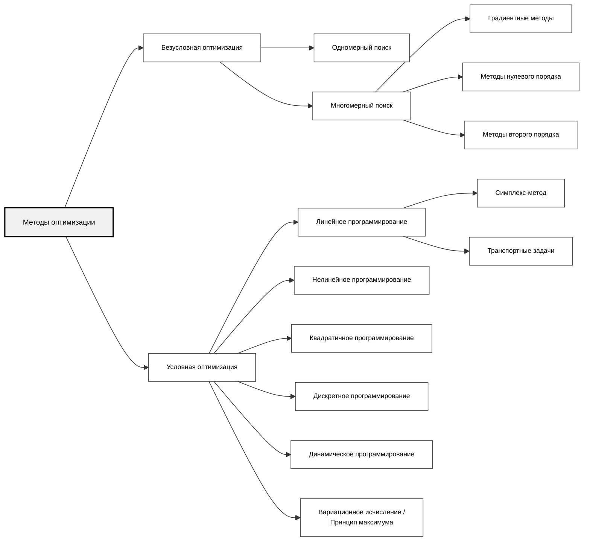

> [!abstract] О чём эта глава
> Мы закладываем фундамент всей дисциплины. Здесь появятся ключевые понятия — *выпуклость*, *экстремум*, *допустимое множество*, — без которых невозможно понять ни симплекс-метод, ни градиентный спуск, ни принцип максимума Понтрягина. После этой главы вы будете смотреть на любую задачу оптимизации как на «ландшафт», у которого есть своя геометрия.

---

## 1.1. Классификация методов оптимизации

> [!tip] Концептуальная аналогия: Навигатор в мультивселенной
> Представьте, что вы — не просто путешественник, ищущий дорогу из точки A в точку B. Вы находитесь в пространстве всех возможных миров (допустимых решений), и ваша цель — найти тот единственный мир, где стоимость путешествия минимальна. Методы оптимизации — это компасы и карты для навигации в этой мультивселенной. Одни компасы работают только на «плоских» мирах (линейное программирование), другие — на искривлённых (нелинейное программирование), третьи — в мирах, где можно ходить только по целым координатам (дискретная оптимизация).

Математическое программирование (МП) — раздел математики, разрабатывающий теорию и численные методы решения многомерных экстремальных задач в том числе с ограничениями.

Общая постановка задачи оптимизации:

$$
f(x) \to \min_{x \in X} \qquad (1.1.1)
$$

где $f(x)$ — **целевая функция** (критерий качества), $X \subseteq \mathbb{R}^n$ — **допустимое множество**, $x^* \in X$ — точка глобального минимума.

### Карта разделов: классы задач и основные методы

### Ключевые классы задач

1. **Безусловная оптимизация:** $X = \mathbb{R}^n$. Никаких стен и заборов — ищем минимум «везде».
2. **Условная оптимизация:** $X \subset \mathbb{R}^n$ задано системой ограничений (равенств или неравенств). Мы ищем дно долины, но нам запрещено наступать на определённые участки земли.
3. **Линейное программирование (ЛП):** и $f(x)$, и ограничения линейны. Это «плоский» мир, где все границы — гиперплоскости, а целевая функция — наклонная плоскость.
4. **Нелинейное программирование (НЛП):** хотя бы одна функция нелинейна. Мир становится искривлённым, появляются «овраги» и «холмы».
5. **Квадратичное программирование:** целевая функция квадратична, ограничения линейны.
6. **Дискретное программирование:** переменные принимают только целые (или булевы) значения. Нельзя построить 2.5 завода.
7. **Динамическое программирование:** решение ищется не в точке, а в виде *последовательности* решений по шагам (этапам) процесса.

> [!warning] Подводный камень
> Не путайте нелинейность со сложностью. Линейная задача с миллионом переменных обычно решается предсказуемо и надёжно, а вот **невыпуклая** нелинейная задача с десятью переменными может оказаться практически нерешаемой (вплоть до NP-трудных случаев). Сложность и выбор метода определяет класс задачи — линейность, выпуклость, дискретность, — а не размерность сама по себе.

---

## 1.2. Выпуклые множества

Прежде чем говорить о функциях, нужно понять «территорию», на которой они живут.

**Определение 1.2.1.** Множество $X \subset \mathbb{R}^n$ называется **выпуклым**, если вместе с любыми двумя своими точками $x^{(1)}, x^{(2)} \in X$ оно содержит и весь отрезок, их соединяющий:

$$
\lambda x^{(1)} + (1-\lambda) x^{(2)} \in X, \quad \forall \lambda \in [0, 1] \qquad (1.2.1)
$$

> [!tip] Концептуальная аналогия: Резиновая лента
> Представьте, что множество $X$ — это территория, огороженная забором. Возьмите резиновую ленту и натяните её между двумя любыми точками внутри этой территории. Если множество выпуклое, резиновая лента *ни в одной своей точке* не выйдет за пределы забора. Если же множество имеет «вмятину» (невыпуклое), то при натяжении ленты между двумя точками по краям вмятины лента пройдёт сквозь «запретную зону» снаружи.

![[ConvexSets.png]]
### Свойства выпуклых множеств

**Теорема 1.2.1.** *Пересечение любого (в том числе бесконечного) семейства выпуклых множеств есть выпуклое множество.*

**Доказательство.** Пусть $X = \bigcap_{\alpha} X_{\alpha}$, где каждое $X_{\alpha}$ выпукло. Возьмём $x^{(1)}, x^{(2)} \in X$ и $\lambda \in [0,1]$. Тогда для каждого $\alpha$ выполнено $x^{(1)}, x^{(2)} \in X_{\alpha}$, и по выпуклости $X_{\alpha}$ точка $\lambda x^{(1)} + (1-\lambda) x^{(2)} \in X_{\alpha}$. Поскольку это верно для всех $\alpha$, точка принадлежит и пересечению $X$. $\blacksquare$

Это свойство — рабочий инструмент: допустимое множество в задаче ЛП задаётся как пересечение конечного числа полупространств, и его выпуклость следует автоматически.

### Крайние точки

**Определение 1.2.2.** Точка $x \in X$ называется **крайней точкой** выпуклого множества $X$, если её нельзя представить в виде $x = \lambda x^{(1)} + (1-\lambda) x^{(2)}$ для некоторых $x^{(1)}, x^{(2)} \in X$, $x^{(1)} \neq x^{(2)}$, $\lambda \in (0,1)$.

Геометрически: крайняя точка — это «вершина», которую нельзя получить как внутреннюю точку никакого отрезка, целиком лежащего в $X$. У выпуклого многогранника крайние точки — это его вершины.

**Теорема 1.2.2 (о крайней точке).** Всякое непустое замкнутое ограниченное (компактное) выпуклое множество $X \subset \mathbb{R}^n$ содержит хотя бы одну крайнюю точку.
**Доказательство (скетч).** Рассмотрим $\varphi(x) = |x|^2$ на $X$. Поскольку $X$ компактно, а $\varphi$ непрерывна, $\varphi$ достигает на $X$ **максимума** в некоторой точке $x^*$. Покажем, что $x^*$ — крайняя. Если бы $x^* = \lambda x^{(1)} + (1-\lambda) x^{(2)}$ при $x^{(1)} \neq x^{(2)}$, $\lambda \in (0,1)$, то по строгой выпуклости $\varphi$:
$$|x^*|^2 < \lambda |x^{(1)}|^2 + (1-\lambda) |x^{(2)}|^2 \le \max\big(|x^{(1)}|^2, |x^{(2)}|^2\big) \le |x^*|^2,$$
где последнее неравенство — максимальность $x^*$. Противоречие. $\blacksquare$

> [!note] Зачем это нужно
> В линейном программировании, если оптимальное решение существует, то **хотя бы одно** достигается в крайней точке (вершине) допустимого многогранника. Оптимум может достигаться и на целом ребре/грани (альтернативный оптимум), но вершина среди оптимумов есть всегда. Весь симплекс-метод — это, по сути, «умный перебор» вершин.

### Выпуклая оболочка

**Определение 1.2.3.** **Выпуклой оболочкой** множества $G$ называется наименьшее выпуклое множество, содержащее $G$. Обозначается $[G]$.

Аналитически: $[G] = \left\{ \sum_{i=1}^{N} \mu_i x^{(i)} \;\middle|\; x^{(i)} \in G,\; \mu_i \ge 0,\; \sum \mu_i = 1,\; N \in \mathbb{N} \right\}$.

По теореме Каратеодори, в $\mathbb{R}^n$ достаточно брать $N \le n+1$.

---

## 1.3. Выпуклые функции

Теперь, когда мы поняли форму «территории», добавим к ней «рельеф».

**Определение 1.3.1.** Функция $f(x)$, заданная на выпуклом множестве $X \subset \mathbb{R}^n$, называется **выпуклой**, если для любых $x^{(1)}, x^{(2)} \in X$ и любого $\lambda \in [0,1]$ выполняется:

$$
f(\lambda x^{(1)} + (1-\lambda) x^{(2)}) \le \lambda f(x^{(1)}) + (1-\lambda) f(x^{(2)}) \qquad (1.3.1)
$$

Если неравенство строгое при $\lambda \in (0,1)$ и $x^{(1)} \neq x^{(2)}$, функция называется **строго выпуклой**.

> [!tip] Концептуальная аналогия: Топологический ландшафт
> Представьте себе многомерный топологический ландшафт, где высота над уровнем моря — это значение функции $f(x)$, а координаты на местности — вектор параметров $x$. Наша задача — найти самую глубокую точку этой долины (глобальный минимум), не провалившись при этом в случайную придорожную выбоину (локальный минимум). Если ландшафт «правильный» (выпуклый), то у него нет скрытых пещер, обратных склонов или изолированных ям. Любая локальная выбоина автоматически является дном всей долины.

![[ConvexFunctions.png]]

### Эпиграф

**Определение 1.3.2.** **Эпиграфом** функции $f$ называется множество

$$
\operatorname{epi} f = \{(x, \mu) \in X \times \mathbb{R} \mid f(x) \le \mu\} \qquad (1.3.2)
$$

Это всё пространство *над* графиком, включая сам график.

**Теорема 1.3.1.** *Функция $f$ выпукла на выпуклом множестве $X$ тогда и только тогда, когда $\operatorname{epi} f$ — выпуклое подмножество $\mathbb{R}^{n+1}$.*

**Доказательство.**

$(\Rightarrow)$ Пусть выполнено (1.3.1). Возьмём $(x, \mu), (y, \nu) \in \operatorname{epi} f$ и $\lambda \in [0,1]$. Тогда $f(x) \le \mu$, $f(y) \le \nu$, и

$$
f(\lambda x + (1-\lambda) y) \le \lambda f(x) + (1-\lambda) f(y) \le \lambda \mu + (1-\lambda) \nu,
$$

то есть точка $\lambda(x, \mu) + (1-\lambda)(y, \nu) \in \operatorname{epi} f$.

$(\Leftarrow)$ Пусть $\operatorname{epi} f$ выпукло. Возьмём $x, y \in X$ и положим $\mu = f(x)$, $\nu = f(y)$. Тогда $(x, \mu), (y, \nu) \in \operatorname{epi} f$, и по выпуклости

$$
(\lambda x + (1-\lambda) y,\; \lambda f(x) + (1-\lambda) f(y)) \in \operatorname{epi} f,
$$

что и есть (1.3.1). $\blacksquare$

### Пять ключевых теорем

**Теорема 1.3.2.** *Линейная форма $f(x) = c^T x$ является одновременно выпуклой и вогнутой на всём $\mathbb{R}^n$.*

**Доказательство.** $f(\lambda x + (1-\lambda) y) = c^T(\lambda x + (1-\lambda) y) = \lambda c^T x + (1-\lambda) c^T y = \lambda f(x) + (1-\lambda) f(y)$. Неравенство превращается в равенство. $\blacksquare$

**Теорема 1.3.3.** *Если $f_1, \dots, f_m$ выпуклы на $X$, то их сумма $f = \sum f_j$ также выпукла.*

**Доказательство.** Суммируем неравенство (1.3.1) для каждой $f_j$:

$$
f(\lambda x + (1-\lambda) y) = \sum f_j(\lambda x + (1-\lambda) y) \le \sum [\lambda f_j(x) + (1-\lambda) f_j(y)] = \lambda f(x) + (1-\lambda) f(y). \quad \blacksquare
$$

**Теорема 1.3.4.** *Если $f$ выпукла и дифференцируема, то её график лежит не ниже касательной гиперплоскости:*

$$
f(y) \ge f(x) + \langle \nabla f(x),\, y - x \rangle \qquad (1.3.3)
$$

**Доказательство.** Из (1.3.1) при $\lambda \in (0,1)$:

$$
\frac{f(x + \lambda(y-x)) - f(x)}{\lambda} \le f(y) - f(x).
$$

Переходя к пределу $\lambda \to 0^+$, получаем $\langle \nabla f(x), y-x \rangle \le f(y) - f(x)$. $\blacksquare$

**Теорема 1.3.5.** *Если $g_i(x)$ — выпуклые функции, то множество $R = \{x \mid g_i(x) \le b_i,\; x \ge 0\}$ выпукло.*

**Доказательство.** Пусть $x, y \in R$. Тогда $g_i(x) \le b_i$, $g_i(y) \le b_i$. По выпуклости $g_i$:

$$
g_i(\lambda x + (1-\lambda) y) \le \lambda g_i(x) + (1-\lambda) g_i(y) \le \lambda b_i + (1-\lambda) b_i = b_i.
$$

Значит, $\lambda x + (1-\lambda) y \in R$. $\blacksquare$

> [!note] Мостик между множествами и функциями
> Теорема 1.3.5 — это ключевой мост: она говорит, что *выпуклость функций-ограничений гарантирует выпуклость допустимой области*. Именно поэтому выпуклое программирование так хорошо изучено: у него «правильная» геометрия.

**Теорема 1.3.6 (Главная теорема выпуклого программирования).** *Если $f$ — выпуклая функция на выпуклом множестве $X$, то любой локальный минимум $f$ на $X$ является глобальным. Если $f$ строго выпукла — глобальный минимум единственен.*

**Доказательство** (от противного). Пусть $x^*$ — локальный, но не глобальный минимум. Тогда существует $x^{**} \in X$ с $f(x^{**}) < f(x^*)$. По определению локального минимума, в некоторой $\varepsilon$-окрестности точки $x^*$ функция не меньше $f(x^*)$. Но точка $x_\lambda = \lambda x^{**} + (1-\lambda) x^*$ при достаточно малых $\lambda > 0$ попадает в эту окрестность, и при этом

$$
f(x_\lambda) \le \lambda f(x^{**}) + (1-\lambda) f(x^*) < \lambda f(x^*) + (1-\lambda) f(x^*) = f(x^*),
$$

что противоречит локальной минимальности $x^*$. $\blacksquare$

> [!warning] Подводный камень
> Выпуклость функции $\neq$ наличие производной. Функция $f(x) = |x|$ строго выпукла и имеет единственный глобальный минимум в $x = 0$, но она не дифференцируема в этой точке. Методы, требующие градиента (Ньютон, наискорейший спуск), могут «споткнуться» в вершине такого «конуса».

---

## 1.4. Постановка задачи оптимизации

Вспомним постановку из §1.1:

$$
\begin{aligned}
& f(x) \to \min_{x \in X} \\
\end{aligned} \qquad (1.1.1)
$$

где:
- $f(x)$ — целевая функция (критерий качества, функционал затрат);
- $X$ — допустимое множество (множество планов);
- $x^* \in X$ — **точка глобального минимума**, если $f(x^*) \le f(x)$ для всех $x \in X$.

### Существование решения: теорема Вейерштрасса

> [!tip] Концептуальная аналогия: Запечатанная коробка
> Представьте, что вы ищете самую низкую точку внутри запечатанной непрозрачной коробки (замкнутое и ограниченное множество), а пол внутри коробки гладкий (непрерывная функция). Теорема Вейерштрасса гарантирует, что самая низкая точка *физически существует*. Вы не можете иметь пол, который уходит в бесконечность вниз, не выходя за границы коробки. Однако теорема не говорит, *где* эта точка и *как* её найти — для этого нужны методы оптимизации.

**Теорема 1.4.1 (Вейерштрасс).** *Если $X \subset \mathbb{R}^n$ — замкнутое ограниченное (компактное) множество, а $f: X \to \mathbb{R}$ — непрерывная функция, то $f$ достигает на $X$ своего глобального минимума и максимума.*

**Доказательство.** По теореме Больцано-Вейерштрасса, из любой ограниченной последовательности можно выделить сходящуюся подпоследовательность. Пусть $\{x_k\} \subset X$ — минимизирующая последовательность, т.е. $f(x_k) \to \inf_X f = m$. Поскольку $X$ компактно, существует сходящаяся подпоследовательность $x_{k_j} \to x^* \in X$ (замкнутость!). По непрерывности $f(x^*) = \lim f(x_{k_j}) = m$. Значит, $x^*$ — точка минимума.
Для максимума применить доказанное к $-f$.
$\blacksquare$

### Классы оптимизационных задач

В зависимости от структуры $f$ и $X$ выделяют:

| Класс                                     | Целевая функция                | Ограничения                                           |
| ----------------------------------------- | ------------------------------ | ----------------------------------------------------- |
| Безусловная оптимизация                   | любая                          | $X = \mathbb{R}^n$                                    |
| Классическая задача на условный экстремум | любая                          | $g_i(x) = 0$                                          |
| **Выпуклое программирование**             | выпуклая                       | $X$ выпукло                                           |
| **Линейное программирование (ЛП)**        | линейная                       | линейные                                              |
| **Квадратичное программирование**         | квадратичная                   | линейные                                              |
| Нелинейное программирование (НЛП)         | хотя бы одна функция нелинейна | допускаются линейные (хотя бы одна функция нелинейна) |
| Дискретное программирование               | любая                          | $x_j \in \mathbb{Z}$                                  |
| Задача оптимального управления            | функционал                     | дифф. уравнения                                       |

---

## 1.5. Практикум

### Проверь себя

> [!question] Задачи для самопроверки
> 1. Докажите, что функция $f(x) = e^x$ строго выпукла на $\mathbb{R}$.
> 2. Является ли множество $X = \{x \in \mathbb{R}^2 \mid x_1^2 + x_2^2 \le 1\}$ выпуклым? А множество $Y = \{x \in \mathbb{R}^2 \mid x_1^2 + x_2^2 = 1\}$?
> 3. Покажите, что функция $f(x) = x^4$ строго выпукла, хотя $f''(0) = 0$. Как это согласуется с достаточным условием выпуклости через гессиан?
> 4. Пусть $f(x) = \max(x_1, x_2, \dots, x_n)$. Докажите, что $f$ выпукла на $\mathbb{R}^n$.

> [!success] Ответы
> 1. $f''(x) = e^x > 0$ для всех $x$.
> 2. $X$ — выпуклый (круг), $Y$ — невыпуклый (окружность, хорда проходит внутри круга, то есть вне $Y$, поэтому $Y$ невыпукло).
> 3. $f'' \ge 0$ всюду $\iff$ выпуклость (нестрогая); строгая выпуклость при этом возможна и с $f''(0)=0$
> 4. $\max(\lambda x + (1-\lambda) y) \le \lambda \max(x) + (1-\lambda) \max(y)$ — максимум линейной комбинации не превосходит линейной комбинации максимумов.

---

## Что дальше?

В **Главе 2** мы перейдём к линейному программированию: разберём геометрический метод решения ЗЛП на плоскости, докажем, что оптимум всегда достигается в вершине многогранника, и познакомимся с двойственностью — одной из самых красивых идей в математике.

> [!quote] Эпиграф к следующей главе
> «Каждая задача линейного программирования носит с собой свою двойственную задачу, как тень носит тело». — приписывается Дж. фон Нейману

