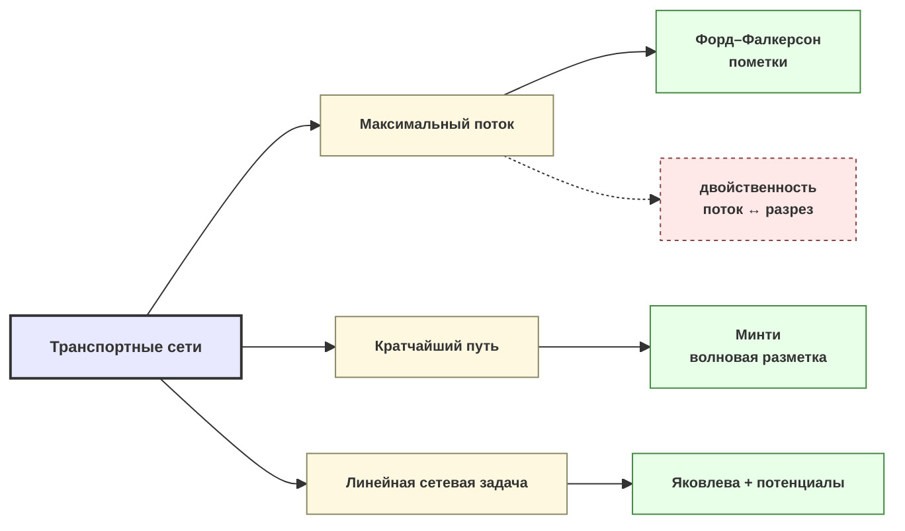

> [!abstract] О чём эта глава
> Эта глава переносит вас из мира матриц в мир графов: вы научитесь описывать перевозочные системы как сети с источниками, стоками и транзитными узлами. Мы докажем, что максимальный поток через сеть равен пропускной способности её самого узкого места — минимального разреза, и построим алгоритм Форда–Фалкерсона, который находит и то, и другое за конечное число шагов. Затем алгоритмом Минти найдём кратчайший путь, а методом потенциалов в связке с алгоритмом Яковлевой — оптимальный поток в линейной сетевой задаче. После этой главы вы будете свободно переводить любую логистическую, коммуникационную или распределительную систему на язык графов и решать на ней три классические задачи.

## 5.1. Язык сетей: графы, потоки, разрезы

Начнём с языка. Сеть — это граф, на вершинах и дугах которого заданы числа: интенсивности, потоки, стоимости, пропускные способности. Без точных определений мы не сможем ни сформулировать задачу, ни доказать теорему.

> [!definition] Определение 5.1.1 (Граф)
> Графом $G(I,U)$ называется пара непустого множества вершин $I$ и множества дуг $U$, где каждая дуга $u\in U$ — упорядоченная пара $(i,j)$ элементов из $I$. Вершина $i$ называется началом, $j$ — концом дуги. Геометрически множество $I$ задаётся точками, а $U$ — линиями со стрелками, соединяющими эти точки.

Если направление дуги несущественно, она называется *ребром* и обозначается $[i,j]$ (линия без стрелки). Граф с такими связями — *неориентированный*. Две вершины, соединённые дугой, называются *смежными*; вершина и инцидентная ей дуга — *инцидентными* друг другу. Вершина, не инцидентная ни одной дуге, — *изолированная*.

> [!definition] Определение 5.1.2 (Путь, контур, связность)
> *Путём* в графе называется последовательность дуг $(u_1,u_2,\dots,u_m)$, где конец каждой дуги совпадает с началом следующей. Конечный путь с совпадающими началом и концом — *контур*. Путь, проходящий через все вершины ровно по одному разу, — *гамильтонов*. Граф *сильно связен*, если любые две вершины соединяются путём.
>
> Если заменить «дуга» на «ребро», получаем *цепь*, *цикл* и обычную *связность*.

Две матричные характеристики графа: *матрица смежности* $A=\|a_{ij}\|_{n\times n}$, где $a_{ij}$ равно числу дуг из $i$ в $j$, и понятие *изоморфизма* — взаимно однозначного соответствия между вершинами двух графов, сохраняющего инцидентность.

> [!warning] Подводный камень
> Путь $\neq$ цепь, контур $\neq$ цикл: первые учитывают ориентацию, вторые — нет. Разрез — это множество **дуг**, а не вершин; путать эти объекты — значит получить неверную оценку пропускной способности.

Теперь — сеть.

> [!definition] Определение 5.1.3 (Сеть)
> *Сетью* называется граф $G(I,U)$, на вершинах которого задана функция интенсивности $d_i$, а на дугах — функция потока $x_{ij}$ и, возможно, функции стоимости $c_{ij}$ и пропускной способности $r_{ij}$.
>
> Вершина называется *источником*, если $d_i>0$, *стоком*, если $d_i<0$, и *нейтральной*, если $d_i=0$.

Поток $x_{ij}$ должен удовлетворять двум группам соотношений. Во-первых, *балансовым* — в каждой вершине приход равен расходу с учётом интенсивности:

$$
\sum_{j} x_{ij} - \sum_{j} x_{ji} = d_i, \quad i\in I \qquad (5.1.1)
$$

Во-вторых, *ограничениям на знак*:

$$
x_{ij} \geq 0, \quad (i,j)\in U \qquad (5.1.2)
$$

Если на дугах задана стоимость $c_{ij}$, возникает *линейная форма* — общая стоимость перевозок:

$$
f(\bar x) = \sum_{(i,j)\in U} c_{ij}\, x_{ij} \qquad (5.1.3)
$$

Задача минимизации $f$ при условиях (5.1.1)–(5.1.2) называется *задачей об оптимальном потоке* (или *линейной сетевой задачей*). Если же на дугах задана функция пропускной способности $r_{ij}\geq 0$, добавляется ограничение

$$
0 \leq x_{ij} \leq r_{ij}, \quad (i,j)\in U \qquad (5.1.4)
$$

и задача называется *задачей о потоке с ограниченными пропускными способностями*.

> [!tip] Концептуальная аналогия: водопровод космической станции
> Представьте орбитальную станцию: отсеки — вершины, в одних идёт производство воды ($d_i>0$), в других — потребление ($d_i<0$), в третьих вода только перекачивается ($d_i=0$). Трубы — дуги, их пропускная способность $r_{ij}$ — максимальный расход через трубу, фактический проток $x_{ij}$ — поток. Балансовое соотношение (5.1.1) означает: в каждом отсеке приток минус отток равен тому, что в отсеке произвели (или потребили). Сквозь эту картинку мы пройдём до конца главы.

Теперь — ключевое понятие для задачи о максимальном потоке.

> [!definition] Определение 5.1.4 (Разрез)
> Пусть в сети есть один источник $s$ и один сток $t$. *Разрезом*, отделяющим $s$ от $t$, называется множество дуг $U(R)=\{(i,j)\mid i\in R,\; j\in R'\}$, где $R$ и $R'$ — разбиение вершин: $R\cup R'=I$, $R\cap R'=\varnothing$, $s\in R$, $t\in R'$. *Величиной разреза* называется сумма пропускных способностей его дуг:
> $$r(R,R') = \sum_{i\in R,\, j\in R'} r_{ij} \qquad (5.1.5)$$
> Разрез с наименьшей величиной называется *минимальным*.

Любой разрез запрещает все пути из $s$ в $t$, поэтому суммарный поток $d$, текущий из источника в сток, не может превысить пропускную способность ни одного разреза:

$$d \leq r(R,R') \qquad (5.1.6)$$

*Максимальным* называется поток с наибольшим возможным значением $d$. Задача отыскания такого $d$ — *задача о максимальном потоке*.

> [!img] №1: ориентированный и неориентированный графы
> Две панели рядом. Левая: ориентированный граф из 6 вершин (кружки с номерами 1–6), 8 дуг — линии со стрелками; выделены жирным один путь из трёх дуг (1→3→5→6) и один контур (2→4→5→2). Правая: неориентированный граф из 5 вершин, 6 рёбер — линии без стрелок; выделены одна цепь и один цикл. Подписи: «Путь», «Контур», «Цепь», «Цикл». Все вершины подписаны номерами, все дуги/рёбра — буквами $a,b,c,\dots$.

> [!img] №2: сеть с разрезом
> Сеть из 7 вершин: источник $s$ (слева, $d_s=+10$), сток $t$ (справа, $d_t=-10$), 5 нейтральных вершин. У каждой вершины подписана интенсивность $d_i$. На дугах подписаны пары $r_{ij}\mid x_{ij}$ (пропускная способность и текущий поток). Пунктирной замкнутой кривой выделено множество $R$ (содержит $s$ и 3 нейтральные вершины); вне кривой — $R'$ (содержит $t$ и 2 нейтральные). Жирными точками отмечены дуги разреза $U(R)$ — те, что идут из $R$ в $R'$; рядом подпись «$r(R,R')=\sum r_{ij}=\dots$».

## 5.2. Максимальный поток и минимальный разрез: Форд–Фалкерсон

Центральный результат теории потоков — теорема, связывающая две, казалось бы, разные задачи.

> [!theorem] Теорема 5.2.1 (Форд–Фалкерсон, 1956)
> Для любой сети величина максимального потока из источника $s$ в сток $t$ равна пропускной способности минимального разреза, отделяющего $s$ от $t$:
> $$d_{\max} = \min_{(R,R')} r(R,R') \qquad (5.2.1)$$

**Доказательство.** Пусть $d$ — величина максимального потока в сети $(I,U)$. Нужно показать, что среди всех разрезов найдётся такой разрез $(R,R')$, для которого $d = r(R,R')$.

*Построение множества $R$.* Определим $R$ рекуррентно, начиная с источника:

$$s \in R; \qquad (5.2.2)$$
$$\text{если } i\in R \text{ и } x_{ij} < r_{ij}, \text{ то } j\in R; \qquad (5.2.3)$$
$$\text{если } i\in R \text{ и } x_{ji} > 0, \text{ то } j\in R'. \qquad (5.2.4)$$

Правило (5.2.3) означает: вершина $j$ попадает в $R$, если из $s$ в $j$ существует цепь, на прямых дугах которой поток не достигает пропускной способности, а на обратных — отличен от нуля.

*Часть 1: $t\in R'$, то есть $(R,R')$ — разрез.* Предположим противное: $t\in R$. Тогда существует цепь $i_1,i_2,\dots,i_m$ из $s=i_1$ в $t=i_m$, причём для всех прямых дуг $(i_k,i_{k+1})$ выполнено $x_{i_k i_{k+1}} < r_{i_k i_{k+1}}$, а для всех обратных $(i_{k+1},i_k)$ — $x_{i_{k+1} i_k} > 0$. Найдём $\varepsilon_1$ — минимум разности $r-x$ по прямым дугам, и $\varepsilon_2$ — минимум $x$ по обратным. Положим $\varepsilon = \min\{\varepsilon_1,\varepsilon_2\} > 0$. Увеличим поток на $\varepsilon$ на всех прямых дугах цепи и уменьшим на $\varepsilon$ на всех обратных. Величина потока возрастёт на $\varepsilon$ — противоречие с максимальностью $d$. Значит, $t\in R'$ и множество дуг $(R,R')$ действительно является разрезом.

*Часть 2: $d = r(R,R')$.* Из правила (5.2.3) следует: если $i\in R$ и $j\in R'$, то $x_{ij} = r_{ij}$ (иначе $j$ попало бы в $R$). Суммируя по всем дугам разреза:

$$d = \sum_{i\in R,\, j\in R'} x_{ij} = \sum_{i\in R,\, j\in R'} r_{ij} = r(R,R'). \qquad \blacksquare$$

> [!note] Мостик
> Задачи о максимальном потоке и минимальном разрезе — двойственная пара в том же смысле, что и прямая/двойственная задачи ЛП ([[Глава 2. Линейное программирование. Основы]]). Алгоритм Форда–Фалкерсона — специализированная реализация симплекс-метода на сетевой структуре ([[Глава 3. Симплекс-метод и его модификации]]).

Алгоритм превращает доказательство в вычислительную процедуру.

**Алгоритм Форда–Фалкерсона (метод пометок).**

*Шаг 1 (наращивание потока).* Пометим источник $s$ меткой $(0,\infty)$. Берём любую помеченную вершину $i$ и рассматриваем все непомеченные вершины $j$, связанные с $i$ дугами:
- если $x_{ij} < r_{ij}$, присваиваем $j$ метку $(i^+,\, \varepsilon_j)$, где $\varepsilon_j = \min\{\varepsilon_i,\; r_{ij}-x_{ij}\}$;
- если $x_{ji} > 0$, присваиваем $j$ метку $(i^-,\, \varepsilon_j)$, где $\varepsilon_j = \min\{\varepsilon_i,\; x_{ji}\}$.

Повторяем, пока не пометим сток $t$ (переход к шагу 2) или пока новые пометки станут невозможны (поток максимален — конец).

*Шаг 2 (проталкивание потока).* Если пометка $t$ имеет вид $(j^+,\varepsilon_t)$, увеличиваем $x_{jt}$ на $\varepsilon_t$; если $(j^-,\varepsilon_t)$, уменьшаем $x_{jt}$ на $\varepsilon_t$. Переходим к вершине $j$ и повторяем операцию, двигаясь обратно к $s$. После достижения $s$ стираем все пометки и возвращаемся к шагу 1.

*Критерий останова.* Сток $t$ не удаётся пометить $\Rightarrow$ текущий поток максимален; минимальный разрез образуют дуги, ведущие из помеченных вершин в непомеченные.

> [!warning] Обратные дуги и метки $(i^-,\cdot)$
> Забыть про обратные дуги — классическая ошибка: без них алгоритм не сможет «откатить» неудачно направленный ранее поток. Начинать можно с любого потока (в том числе нулевого), но ненулевой начальный поток сходится быстрее.

> [!tip] Концептуальная аналогия: закон самого узкого перевала
> Представьте осаждённый горный город: все маршруты снабжения упираются в перевалы. Пропускная способность колонны снабжения равна пропускной способности самого узкого набора перевалов, пересекающих все тропы. Минимальный разрез — и есть этот «самый узкий перевал»; теорема Форда–Фалкерсона утверждает, что больший поток через город провести нельзя в принципе.

**Разобранный пример.** Сеть на рис. 3.1 пособия (8 вершин, исток 1, сток 6; пропускные способности симметричны в обоих направлениях).

Начинаем с ненулевого потока $d=9$ (рис. 3.2 пособия).

*Итерация 1.* Шаг 1: помечаем вершины от $1$. Сток $6$ получает пометку. Шаг 2: проталкиваем $\varepsilon=3$, получаем $d=12$ (рис. 3.3).

*Итерация 2.* Сеть на рис. 3.3. Пометки расставляются заново; сток $6$ снова помечен. Проталкиваем $\varepsilon=2$, получаем $d=14$ (рис. 3.4).

*Итерация 3.* Сеть на рис. 3.4. Снова помечаем; сток $6$ помечен. Проталкиваем $\varepsilon=2$, получаем $d=16$ (рис. 3.5).

*Итерация 4.* Сеть на рис. 3.5. Пытаемся расставить пометки от $1$. Сток $6$ **не удаётся пометить** — конец алгоритма. $d_{\max}=16$.

Множество помеченных вершин $R=\{1,2,3,4,5,7,8\}$, непомеченных $R'=\{6\}$. Минимальный разрез — дуги из $R$ в $R'$: $\{(3,6),\,(4,6),\,(8,6)\}$. Его пропускная способность: $r = 11+3+2 = 16 = d_{\max}$. Теорема подтверждена.

> [!img] №3: сеть с пометками одной итерации
> Та же сеть из 8 вершин, что на рис. 3.2 пособия. На рёбрах — пары $r\mid d$ (пропускная способность | текущий поток). У вершин — пометки вида $(i^+,\varepsilon)$ или $(i^-,\varepsilon)$ в круглых скобках; у источника $(0,\infty)$. Стрелками показано, от какой вершины к какой передавалась пометка. Жирным выделена цепь от $1$ до $6$, по которой будет проталкиваться поток.

> [!img] №4: итоговый поток и минимальный разрез
> Та же сеть, итоговый поток $d=16$. На рёбрах — итоговые пары $r\mid d$. Пунктирной замкнутой кривой выделено множество $R=\{1,2,3,4,5,7,8\}$; вне кривой — $R'=\{6\}$. Жирными точками отмечены дуги разреза $(3,6)$, $(4,6)$, $(8,6)$; рядом подпись «$r(R,R')=11+3+2=16=d_{\max}$».

## 5.3. Кратчайший путь: алгоритм Минти

Задача о кратчайшем пути — частный случай задачи об оптимальном потоке, в котором, кроме пропускных способностей (они считаются неограниченными), на дугах задана *длина* $c_{ij}$. Требуется найти путь наименьшей длины из $s$ в $t$.

Математически:

$$\sum_{(i,j)\in U} c_{ij}\, x_{ij} \to \min, \qquad (5.3.1)$$

при балансовых условиях $d_s=+1$, $d_t=-1$, $d_i=0$ для остальных вершин, и $x_{ij}\geq 0$.

Алгоритм Минти связывает кратчайшими путями фиксированную вершину $s$ со всеми остальными.

**Алгоритм Минти.**

*Предварительный шаг.* Пометим вершину $s$ числом $\varepsilon_s = 0$.

*Общий шаг.* Пусть $A\subset I$ — множество помеченных вершин, для каждой $i\in A$ известна пометка $\varepsilon_i$. Рассмотрим все дуги $(i,j)$, исходящие из вершин $A$ и заканчивающиеся в непомеченных вершинах $j\in A'$. Для каждой такой дуги вычисляем кандидата $\varepsilon_i + c_{ij}$. Помечаем числом

$$\varepsilon_j = \min_{(i,j)\in (A,A')} (\varepsilon_i + c_{ij}) \qquad (5.3.2)$$

те вершины $j\in A'$, на которых этот минимум достигается, и выделяем соответствующие дуги. Повторяем, пока не пометим вершину $t$. Число $\varepsilon_t$ и есть длина кратчайшего пути из $s$ в $t$.

> [!note] Замечание о формуле
> В печатном издании пособия 2021 формула характеристики записана как $h_{ij} = \varepsilon_i - c_{ij}$, но числовой пример на рис. 3.6 и все выкладки соответствуют $h_{ij} = \varepsilon_i + c_{ij}$. Мы следуем **примеру**: $\varepsilon_j = \min(\varepsilon_i + c_{ij})$, что соответствует классической схеме Дейкстры–Минти для неотрицательных длин.

*Завершающий шаг.* Кратчайший путь восстанавливаем, двигаясь от $t$ к $s$ по выделенным дугам в направлении, обратном их ориентации.

> [!tip] Концептуальная аналогия: волна наводнения
> Представьте, что в вершине $s$ прорвало дамбу. Вода растекается волной по рёбрам сети; $\varepsilon_i$ — момент, когда вода дошла до вершины $i$. Выделенные дуги — русла, по которым волна пришла первой. Кратчайший путь — это цепочка таких русел от истока до точки $t$.

> [!warning] Что такое $\varepsilon_i$
> $\varepsilon_i$ — это **расстояние от $s$ до вершины $i$**, а не длина ребра. В этом алгоритме (при неотрицательных длинах) вершина помечается один раз и больше не перепомечается.

**Разобранный пример.** Сеть рис. 3.6 пособия: 10 вершин, рёбра двусторонние (длины подписаны). Исток — вершина 1.

*Шаг 1.* Помечаем вершину 1: $\varepsilon_1=0$, $N=0$. Из 1 выходят рёбра в 2 (длина 1), 5 (длина 4), 6 (длина 10). Минимум $0+1=1$ — помечаем вершину 2: $\varepsilon_2=1$, $N=1$.

*Шаг 2.* Из множества $\{1,2\}$ рассматриваем рёбра в непомеченные вершины. Минимум достигается на ребре $(2,3)$: $1+2=3$. Помечаем вершину 3: $\varepsilon_3=3$, $N=2$.

Далее процесс продолжается: $\varepsilon_5=3$ ($N=2$, через ребро $(2,5)$ длины 2), $\varepsilon_4=5$ ($N=3$), $\varepsilon_9=11$ ($N=7$), $\varepsilon_8=8$ ($N=4$), $\varepsilon_6=10$ ($N=10$), $\varepsilon_{10}=14$ ($N=8$).

Ответ: $\varepsilon_{10}=14$. Кратчайший путь восстанавливаем против ориентации выделенных дуг: $1\to 2\to 5\to 9\to 10$.

> [!note] Мостик
> Та же задача о кратчайшем пути решается методом динамического программирования ([[Глава 10. Динамическое программирование]], «Задача о кратчайшем пути»). Сравните философии: Минти работает «вширь», охватывая сразу множество вершин; ДП идёт «по шагам», рекуррентно достраивая решение.

> [!img] №5: сеть с кратчайшим путём
> Та же сеть из 10 вершин, что на рис. 3.6 пособия. На рёбрах подписаны их длины. У каждой вершины — двойная пометка: $\varepsilon_i$ (кратчайшее расстояние) и $N$ (номер шага, на котором вершина помечена). Двойными стрелками выделен кратчайший путь $1\to\cdots\to 10$; рядом подпись «$\varepsilon_{10}=14$».

## 5.4. Линейная сетевая задача: потенциалы и алгоритм Яковлевой

Теперь — самая общая постановка. В сети заданы интенсивности $d_i$ (не обязательно $\pm 1$), стоимости $c_{ij}$ на дугах, пропускные способности не ограничены. Необходимо условие баланса:

$$\sum_{i\in I} d_i = 0 \qquad (5.4.1)$$

Вершины с $d_i>0$ — пункты производства, с $d_i<0$ — пункты потребления, с $d_i=0$ — транзитные.

> [!theorem] Теорема 5.4.1 (критерий оптимальности через потенциалы)
> Согласно второй теореме двойственности, оптимальному потоку соответствует набор потенциалов $u_i$, $i\in I$, такой что:
> - при $x_{ij}^* > 0$ (дуга в базисе): $u_j^* - u_i^* = c_{ij}$;
> - при $x_{ij}^* = 0$ (дуга небазисная): $u_j^* - u_i^* \leq c_{ij}$.
>
> Для неориентированного ребра $[i,j]$ оценка небазисности:
> $$\varepsilon_{ij} = c_{ij} - |u_i - u_j| \geq 0 \qquad (5.4.2)$$
> План оптимален тогда и только тогда, когда $\varepsilon_{ij}\geq 0$ для всех небазисных рёбер.

Система ограничений (5.4.1) имеет ранг $N-1$ (где $N=|I|$) — скетч доказательства см. в технике главы 4 для транспортной задачи. Базис образуют $N-1$ дуга, и они должны составлять *остовное дерево* — связный граф без циклов. Наличие цикла в базисе означало бы линейную зависимость базисных векторов.

План решения: сначала алгоритмом Яковлевой строим допустимый базисный план, затем методом потенциалов его оптимизируем.

**Алгоритм Яковлевой. Процесс 1 — построение базисного дерева.**

Каждую базисную дугу отмечаем линией с двумя стрелками. Пометка вершины — число базисных дуг, инцидентных ей.

1. Всем вершинам присваиваем нулевые пометки.
2. В качестве первой базисной дуги выбираем любое ребро, помечаем его двустрелочной линией, увеличиваем на 1 пометки обеих его вершин.
3. Поочерёдно связываем базисными дугами вершины с нулевой пометкой и вершины с ненулевой пометкой. При проведении очередной базисной дуги пометки её вершин увеличиваем на 1.
4. Построение закончено, когда все вершины имеют ненулевые пометки.

**Процесс 2 — ориентация и величины потоков.**

1. Выбираем любую вершину с пометкой 1. Базисной дуге, инцидентной ей, придаём направление по знаку $d_i$: при $d_i<0$ дуга входит в вершину, при $d_i>0$ — выходит, при $d_i=0$ — произвольно.
2. Величину потока по дуге принимаем равной $|d_i|$.
3. Пометки обеих вершин дуги уменьшаем на 1; интенсивности вершин корректируем с учётом потока.
4. Повторяем, выбирая вершину с единичной пометкой, пока все интенсивности не станут нулевыми.

**Общий этап — метод потенциалов на сети.**

*Шаг 1.* Произвольной вершине присваиваем любое значение потенциала (в примере — $u_1=10$). Двигаясь по базисным дугам, вычисляем потенциалы остальных: если дуга выходит из вершины, к потенциалу прибавляем $c_{ij}$; если входит — вычитаем.

*Шаг 2.* Для всех небазисных рёбер вычисляем $\varepsilon_{ij} = c_{ij} - |u_i - u_j|$. Если все $\varepsilon_{ij}\geq 0$ — план оптимален, конец. Иначе — переход к шагу 3.

*Шаг 3.* Одно небазисное ребро с $\varepsilon_{ij}<0$ вводим в базис. Составляем единственный цикл из этого ребра и базисных дуг.

*Шаг 4.* Ориентируем новое ребро в цикле от вершины с меньшим потенциалом к вершине с большим. Двигаемся по базисной цепи от конца нового ребра к его началу. Среди базисных дуг, направление которых противоположно нашему движению, выбираем дугу с наименьшим потоком $\theta$. Выполняем перераспределение: $+\theta$ дугам, совпадающим по направлению с новым ребром, $-\theta$ — противоположным. Дуга с потоком $\theta$ уходит из базиса. Переход к шагу 1.

> [!tip] Концептуальная аналогия: давление в трубах
> Потенциал $u_i$ — давление в узле $i$. Базисная дуга с ненулевым потоком — труба, в которой перепад давлений точно равен стоимости прокачки: $u_j - u_i = c_{ij}$. Оценка $\varepsilon_{ij}<0$ для небазисного ребра означает: «эту трубу выгодно открыть — перепад давлений $|u_i-u_j|$ больше стоимости $c_{ij}$, и через неё потечёт поток».

> [!warning] Знаки и вырожденность
> Знак $c_{ij}$ при ходе по базисной дуге зависит от направления дуги. Модуль в формуле $\varepsilon_{ij} = c_{ij} - |u_i-u_j|$ обязателен: ребро неориентировано. Базисная дуга с нулевым потоком остаётся в базисе — это вырожденность, она не ломает алгоритм, но требует внимания при выборе уходящей дуги.

**Разобранный пример** (рис. 3.7 пособия). Неориентированный граф из 5 вершин. Интенсивности: $d_1=20$, $d_4=5$, $d_5=10$, $d_2=-30$, $d_3=-5$ (баланс: $20+5+10-30-5=0$). Стоимости: $c[12]=5$, $c[15]=8$, $c[52]=3$, $c[53]=4$, $c[54]=6$, $c[43]=2$, $c[23]=1$.

*Процесс 1.* Выбираем ребро $[1,5]$, затем $[5,3]$, $[5,4]$, $[3,2]$. Базисное дерево построено, все пометки ненулевые.

*Процесс 2.* Последовательно обрабатываем вершины с пометкой 1, **корректируя интенсивности после каждой дуги**:
1. Вершина 1 с $d_1=20$: дуга $(1,5)$ orientируется из 1, $x_{15}=20$; корректируем $d_5 := 10+20 = 30$.
2. Вершина 4 с $d_4=5$: дуга $(4,5)$ orientируется из 4, $x_{45}=5$; корректируем $d_5 := 30+5 = 35$.
3. Вершина 5 с **скорректированным** $d_5=35$: дуга $(5,3)$ orientируется из 5, $x_{53}=35$; корректируем $d_3 := -5+35 = 30$.
4. Вершина 3 с **скорректированным** $d_3=30$: дуга $(3,2)$ orientируется из 3, $x_{32}=30$; корректируем $d_2 := -30+30 = 0$.

Итог: $x_{15}=20$, $x_{45}=5$, $x_{53}=35$, $x_{32}=30$. Начальная стоимость: $f = 8\cdot20 + 6\cdot5 + 4\cdot35 + 1\cdot30 = 360$.

*Итерация 1.* Потенциалы (при $u_1=10$):
- $[1,5]$ выходит из 1: $u_5 = 10+8 = 18$;
- $[5,4]$ входит в 5 (т.е. дуга $(4,5)$ ориентирована из 4 в 5): $u_4 = 18-6 = 12$;
- $[5,3]$ выходит из 5: $u_3 = 18+4 = 22$;
- $[3,2]$ выходит из 3: $u_2 = 22+1 = 23$.

Оценки небазисных рёбер:
- $\varepsilon[12] = 5 - |10-23| = -8$;
- $\varepsilon[52] = 3 - |18-23| = -2$;
- $\varepsilon[43] = 2 - |12-22| = -8$.

План не оптимален. В базис — ребро $[1,2]$ (одно из самых отрицательных). Цикл: $[1,2],\,(3,2),\,(5,3),\,(1,5)$. Ориентация $[1,2]$ — от $u_1=10$ к $u_2=23$. Цепь от 2 к 1: $2\leftarrow 3\leftarrow 5\leftarrow 1$. Дуги противоположного направления: $(3,2)$ с $x_{32}=30$, $(5,3)$ с $x_{53}=35$, $(1,5)$ с $x_{15}=20$. Минимум $\theta=20$, уходит $(1,5)$.

Перераспределение: $x_{12}=20$, $x_{32}=30-20=10$, $x_{53}=35-20=15$, $x_{45}=5$ без изменений. Новый план: $x_{12}=20$, $x_{45}=5$, $x_{53}=15$, $x_{32}=10$. Стоимость: $f = 5\cdot20 + 6\cdot5 + 4\cdot15 + 1\cdot10 = 200$.

> [!note] О выборе ребра, вводимого в базис
> Алгоритм допускает введение **любого** ребра с отрицательной оценкой $\varepsilon_{ij}$; правило «самой отрицательной $\varepsilon$» — эвристика, сокращающая типичное число итераций, но не обязательное условие сходимости. Здесь мы сознательно вводим $[5,2]$ ($\varepsilon=-2$), а не $[4,3]$ ($\varepsilon=-8$): эта цепочка итераций приводит к вырожденному случаю на шаге 3, который важно показать. При выборе $[4,3]$ метод сходится к тому же оптимуму $f^*=140$.

*Итерация 2.* Базис: $[1,2],\,[4,5],\,[5,3],\,[3,2]$. Потенциалы (при $u_1=10$):
- $[1,2]$ выходит из 1: $u_2 = 10+5 = 15$;
- $[3,2]$ выходит из 3: $u_3 = 15-1 = 14$;
- $[5,3]$ выходит из 5: $u_5 = 14-4 = 10$;
- $[4,5]$ входит в 5: $u_4 = 10-6 = 4$.

Оценки небазисных:
- $\varepsilon[15] = 8 - |10-10| = 8$;
- $\varepsilon[52] = 3 - |10-15| = -2$;
- $\varepsilon[43] = 2 - |4-14| = -8$.

В базис — ребро $[5,2]$ ($\varepsilon=-2$). Цикл: $[5,2],\,(3,2),\,(5,3)$. Ориентация $[5,2]$ — от $u_5=10$ к $u_2=15$. Цепь от 2 к 5: $2\leftarrow 3\leftarrow 5$. Дуги противоположного направления: $(3,2)$ с $x_{32}=10$, $(5,3)$ с $x_{53}=15$. Минимум $\theta=10$, уходит $(3,2)$.

Перераспределение: $x_{52}=10$, $x_{32}=10-10=0$, $x_{53}=15-10=5$. Новый план: $x_{12}=20$, $x_{45}=5$, $x_{53}=5$, $x_{52}=10$. Стоимость: $f = 5\cdot20 + 6\cdot5 + 4\cdot5 + 3\cdot10 = 180$.

*Итерация 3.* Базис: $[1,2],\,[4,5],\,[5,3],\,[5,2]$. Потенциалы (при $u_1=10$):
- $[1,2]$ выходит из 1: $u_2 = 10+5 = 15$;
- $[5,2]$ выходит из 5: $u_5 = 15-3 = 12$;
- $[5,3]$ выходит из 5: $u_3 = 12+4 = 16$;
- $[4,5]$ входит в 5: $u_4 = 12-6 = 6$.

Оценки небазисных:
- $\varepsilon[15] = 8 - |10-12| = 6$;
- $\varepsilon[32] = 1 - |16-15| = 0$;
- $\varepsilon[43] = 2 - |6-16| = -8$.

В базис — ребро $[4,3]$ ($\varepsilon=-8$). Цикл: $[4,3],\,(5,3),\,(4,5)$. Ориентация $[4,3]$ — от $u_4=6$ к $u_3=16$. Цепь от 3 к 4: $3\leftarrow 5\leftarrow 4$. Дуги противоположного направления: $(5,3)$ с $x_{53}=5$, $(4,5)$ с $x_{45}=5$. Минимум $\theta=5$ — **вырождение**: обе дуги обнуляются. Из базиса выводим $(4,5)$, дугу $(5,3)=0$ оставляем в базисе.

Перераспределение: $x_{43}=5$, $x_{53}=5-5=0$ (остаётся в базисе), $x_{45}=5-5=0$ (уходит). Новый план: $x_{12}=20$, $x_{52}=10$, $x_{43}=5$, $x_{53}=0$. Стоимость: $f = 5\cdot20 + 3\cdot10 + 2\cdot5 + 4\cdot0 = 140$.

*Проверка оптимальности.* Базис: $[1,2],\,[5,3]=0,\,[5,2],\,[4,3]$. Базисная дуга $[5,3]$ с нулевым потоком формально сохраняется в базисе (признак вырожденности) и используется для вычисления потенциалов. Потенциалы (при $u_1=10$):
- $[1,2]$: $u_2 = 10+5 = 15$;
- $[5,2]$: $u_5 = 15-3 = 12$;
- $[5,3]$: $u_3 = 12+4 = 16$;
- $[4,3]$ входит в 3: $u_4 = 16-2 = 14$.

Оценки небазисных:
- $\varepsilon[15] = 8 - |10-12| = 6\geq 0$;
- $\varepsilon[45] = 6 - |14-12| = 4\geq 0$;
- $\varepsilon[32] = 1 - |16-15| = 0\geq 0$.

Все оценки неотрицательны — план оптимален, $f^*=140$.

> [!note] Мостик
> Это сетевая версия метода потенциалов из [[Глава 4. Транспортные задачи линейного программирования]]. Знаки отличаются: в матричной ТЗ направление «поставщик$\to$потребитель» зафиксировано ($u_i+v_j=c_{ij}$), а здесь у дуги сети есть собственное направление, и потенциалы вычисляются проходом по базисному дереву.

> [!img] №6: процесс 1 алгоритма Яковлевой
> Граф из 5 вершин (как на рис. 3.7 пособия). Базисные дуги $[1,5],\,[5,3],\,[5,4],\,[3,2]$ изображены линиями с двумя стрелками на концах. У каждой вершины — пометка (число инцидентных базисных дуг): у вершины 5 — «3», у вершин 1, 3 — «1», у вершин 2, 4 — «1» (после завершения процесса). Рядом с вершинами подписаны интенсивности $d_i$.

> [!img] №7: процесс 2 — ориентация и потоки
> Тот же граф. Базисные дуги ориентированы одинарными стрелками согласно знаку $d_i$: $(1,5)$ из 1 в 5, $(4,5)$ из 4 в 5, $(5,3)$ из 5 в 3, $(3,2)$ из 3 в 2. На дугах подписаны величины потоков: $x_{15}=20$, $x_{45}=5$, $x_{53}=35$, $x_{32}=30$. У вершин — скорректированные интенсивности (все нулевые в конце процесса).

> [!img] №8: потенциалы и цикл перераспределения (итерация 1)
> Граф с текущим базисом итерации 1. У вершин подписаны потенциалы: $u_1=10$, $u_5=18$, $u_4=12$, $u_3=22$, $u_2=23$. У небазисных рёбер подписаны оценки $\varepsilon_{ij}$: $\varepsilon[12]=-8$, $\varepsilon[52]=-2$, $\varepsilon[43]=-8$. Жирной пунктирной линией выделен цикл перераспределения $[1,2]\to(3,2)\to(5,3)\to(1,5)$; на дугах цикла — стрелки, показывающие направление перераспределения ($\theta=20$).

> [!img] №9: итоговый оптимальный план
> Граф с итоговым базисом $[1,2],\,[5,3]=0,\,[5,2],\,[4,3]$. На дугах подписаны потоки: $x_{12}=20$, $x_{52}=10$, $x_{43}=5$, $x_{53}=0$. Рядом с графом — подпись «$f^*=140$». Базисная дуга $[5,3]$ с нулевым потоком изображена пунктиром (признак вырожденности).

## 5.5. Практикум

> [!question] Задачи
> 1. Докажите: для любого потока $x$ и любого разреза $(R,R')$, отделяющего $s$ от $t$, величина потока $d \leq r(R,R')$.
> 2. Метод Форда–Фалкерсона: сеть из 6 вершин с источником $d_1=+8$, стоком $d_6=-8$ и пропускными способностями $r_{12}=5$, $r_{13}=4$, $r_{24}=6$, $r_{34}=3$, $r_{25}=4$, $r_{45}=2$, $r_{46}=7$, $r_{56}=5$. Старт с нулевого потока. Найти $d_{\max}$ и минимальный разрез.
> 3. Почему в базисных дугах сетевого плана не может быть цикла? (Связать с линейной независимостью векторов условий.)
> 4. Алгоритм Минти: в сети рис. 3.6 изменить длину ребра $(2,3)$ с 2 на 10. Найти новые $\varepsilon_{10}$ и кратчайший путь.
> 5. Алгоритм Яковлевой: построить начальный базисный план для сети рис. 3.7 при $d_1=25$, $d_4=5$, $d_5=5$, $d_2=-30$, $d_3=-5$ (прочие данные — те же) и вычислить $f$.

> [!success] Ответы
> 1. Суммируем балансовые равенства (5.1.1) по всем $i\in R$. В левой части остаётся $\sum_{i\in R,\,j\in R'} x_{ij} - \sum_{i\in R',\,j\in R} x_{ji} = \sum_{i\in R} d_i = d$ (поскольку $d_s=d$, $d_t=0$ для $t\in R'$). Каждая $x_{ij}\leq r_{ij}$, поэтому $d \leq \sum_{i\in R,\,j\in R'} r_{ij} = r(R,R')$.
> 2. $d_{\max}=8$. Минимальный разрез: $R=\{1,3\}$, $R'=\{2,4,5,6\}$, дуги разреза $\{(1,2),\,(3,4)\}$, $r=5+3=8$. Проверка: после трёх итераций проталкивания (5 по пути 1→2→4→6, 2 по 1→3→4→6, 1 по 1→3→4→5→6) сток 6 не помечается.
> 3. Каждой дуге $(i,j)$ соответствует вектор условий $e_i - e_j$ в $\mathbb{R}^N$. Если в базисе есть цикл $i_1\to i_2\to\cdots\to i_k\to i_1$, то сумма соответствующих векторов равна нулю — векторы линейно зависимы, что противоречит определению базиса.
> 4. Ребро $(2,3)$ не входит в кратчайший путь $1\to 2\to 5\to 9\to 10$, найденный в §5.3, поэтому увеличение его длины с 2 до 10 не меняет ни пометок на этом пути, ни его длины: новый кратчайший путь — $1\to 2\to 5\to 9\to 10$, $\varepsilon_{10}=14$.
> 5. Баланс: $25+5+5-30-5=0$. Процесс 1 даёт базис $[1,5],\,[5,3],\,[5,4],\,[3,2]$. Процесс 2 с корректировкой интенсивностей: $x_{15}=25$ ($d_5:=5+25=30$), $x_{45}=5$ ($d_5:=30+5=35$), $x_{53}=35$ ($d_3:=-5+35=30$), $x_{32}=30$ ($d_2:=-30+30=0$). Стоимость: $f = 8\cdot25 + 6\cdot5 + 4\cdot35 + 1\cdot30 = 200+30+140+30 = 400$.

---

Мы закончили с дискретными структурами — графами, потоками, деревьями. В следующей главе мы перейдём к гладким функциям и классическим методам отыскания их экстремума. Окажется, что за кажущейся непохожестью задач на сетях и задач на гладких функциях стоит одна и та же идея: движение от приближения к приближению, пока не будет достигнут оптимум.

> [!quote] Эпиграф
> «Вселенная, как совершеннейшее творение Творца, устроена так, что ничего в ней не происходит без правила максимума или минимума».
> — *Леонард Эйлер*

---

Связанные разделы: [[Глава 2. Линейное программирование. Основы]], [[Глава 3. Симплекс-метод и его модификации]], [[Глава 4. Транспортные задачи линейного программирования]], [[Глава 10. Динамическое программирование]].
