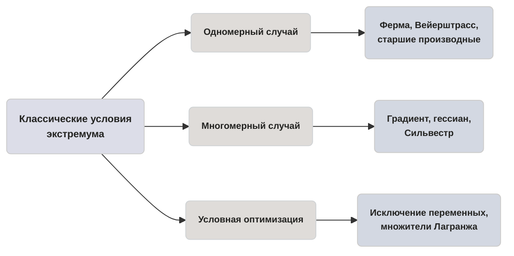

> [!abstract] О чём эта глава
> До сих пор мы работали с линейными моделями. Теперь переходим к гладким функциям и учимся находить их экстремумы — сначала в одной переменной, потом во многих, а затем и при ограничениях-равенствах. Вы освоите теоремы Ферма и Вейерштрасса, критерий Сильвестра для гессиана, метод множителей Лагранжа и поймёте, почему классические условия молчат в вырожденных случаях. После этой главы вы будете находить и классифицировать стационарные точки, а там, где аналитика заканчивается, — знать, куда идти дальше.

## 6.1. Одномерный случай: необходимые и достаточные условия

Начнём с самого простого: функция одной переменной $f\colon X\subset \mathbb{R}\to\mathbb{R}$.

> [!definition] Определение 6.1.1 (Локальный и глобальный экстремум). 
> Точка $x^*\in X$ называется точкой *локального минимума*, если существует окрестность $U\ni x^*$ такая, что $f(x^*)\leq f(x)$ для всех $x\in U\cap X$. Если неравенство строгое при $x\neq x^*$, минимум называется *строгим*. *Глобальный минимум* — это точка, в которой значение функции не превосходит значений во всей области $X$. Для максимума определения зеркальны.

Геометрически: локальный экстремум — это «яма» или «холм» в окрестности точки, глобальный — самая глубокая яма или самая высокая вершина на всей области.

> [!theorem] Теорема 6.1.1 (Вейерштрасс).
>  Непрерывная функция на компактном множестве (замкнутом и ограниченном в $\mathbb{R}^n$) достигает на нём и минимума, и максимума.

**Доказательство.** Пусть $X\subset\mathbb{R}$ — компакт, $f$ непрерывна на $X$. Обозначим $m=\inf_{x\in X}f(x)$. По определению точной нижней грани существует последовательность $x_n\in X$ такая, что $f(x_n)\to m$. Поскольку $X$ компактен, из $\{x_n\}$ можно выделить сходящуюся подпоследовательность $x_{n_k}\to x^*\in X$. По непрерывности $f(x^*)=\lim f(x_{n_k})=m$, то есть $x^*$ — точка минимума. Для максимума рассуждение аналогично. $\blacksquare$

>[!warning] Оба условия существенны
>Контрпример 1 (незамкнутость): $f(x)=x$ на интервале $(0,1)$. Функция непрерывна, но множество не замкнуто. Инфимум равен $0$, но не достигается, так как $0 \notin (0,1)$.
>Контрпример 2 (неограниченность/разрыв): $f(x)=1/x$ на $(0,1]$. Множество не замкнуто. Минимум достигается ($f(1)=1$), но максимум не существует ($\sup = +\infty$).
>Контрпример 3 (разрыв на компакте): $f(x)=x$ при $x<0$ и $f(x)=x-1$ при $x\geq 0$ на отрезке $[-1,1]$. Компакт есть, но функция разрывна в нуле. Инфимум равен $-1$ (в точке 0), но если бы мы взяли функцию $f(x)=x$ при $x<1$ и $f(1)=0$, то супремум $1$ не достигался бы внутри из-за скачка.

> [!theorem] Теорема 6.1.2 (Ферма, необходимое условие).
>  Если $x^*$ — точка локального экстремума функции $f$, дифференцируемой в $x^*$, то $f'(x^*)=0$.

**Доказательство.** Пусть $x^*$ — точка локального минимума (для максимума аналогично). По определению производной: $f'(x^*)=\lim_{h\to 0}\frac{f(x^*+h)-f(x^*)}{h}$. При $h>0$ числитель $\geq 0$, значит правый предел $\geq 0$; при $h<0$ числитель $\geq 0$, знаменатель $<0$, значит левый предел $\leq 0$. Поскольку производная существует, оба предела равны $f'(x^*)$, откуда $f'(x^*)=0$. $\blacksquare$

Геометрически: в точке экстремума гладкой функции касательная горизонтальна.

> [!tip] Концептуальная аналогия: горизонталь на перевале
> Горизонтальная касательная бывает и на вершине холма, и на дне долины, и на «полке»-седле, где функция идёт ровно, а потом снова вниз. Поэтому условие $f'=0$ необходимо, но не достаточно: оно лишь отбирает *кандидаты* — стационарные точки.

> [!definition] Определение 6.1.2 (Стационарная точка).
>  Точка, в которой $f'(x)=0$, называется стационарной.

> [!theorem] Теорема 6.1.3 (Достаточное условие 2-го порядка).
>  Пусть $f$ дважды непрерывно дифференцируема, $f'(x^*)=0$. Тогда:
> - если $f''(x^*)>0$, то $x^*$ — точка строгого локального минимума;
> - если $f''(x^*)<0$, то $x^*$ — точка строгого локального максимума;
> - если $f''(x^*)=0$, тест молчит — экстремум может быть, а может и не быть.

**Доказательство.** Разложим $f$ по Тейлору: $f(x^*+h)=f(x^*)+f'(x^*)h+\frac{1}{2}f''(x^*)h^2+o(h^2)$. Поскольку $f'(x^*)=0$, получаем $f(x^*+h)-f(x^*)=\frac{1}{2}f''(x^*)h^2+o(h^2)$. При $f''(x^*)>0$ и достаточно малых $h$ правая часть положительна при $h\neq 0$, откуда строгий минимум. $\blacksquare$

> [!theorem] Теорема 6.1.4 (Условия старших порядков, скетч).
>  Пусть $f$ имеет в $x^*$ производные до порядка $n$ включительно, причём $f'(x^*)=\dots=f^{(n-1)}(x^*)=0$, а $f^{(n)}(x^*)\neq 0$. Тогда:
> - если $n$ чётно и $f^{(n)}(x^*)>0$ — строгий локальный минимум;
> - если $n$ чётно и $f^{(n)}(x^*)<0$ — строгий локальный максимум;
> - если $n$ нечётно — экстремума нет.

**Доказательство (скетч).** Разложение Тейлора даёт $f(x^*+h)-f(x^*)=\frac{f^{(n)}(x^*)}{n!}h^n+o(h^n)$. При чётном $n$ знак $h^n$ не зависит от знака $h$, и экстремум определяется знаком $f^{(n)}(x^*)$. При нечётном $n$ знак $h^n$ меняется с $h$, поэтому разность меняет знак — экстремума нет. $\blacksquare$

**Правило поиска глобального минимума на $[a,b]$.**
1. Найти все критические точки: где $f'(x)=0$ или $f'$ не существует.
2. Вычислить значения $f$ во всех критических точках, лежащих внутри $(a,b)$, и на концах $f(a)$, $f(b)$.
3. Наименьшее из этих значений — глобальный минимум.

> [!img] №1: две панели
> ЛЕВАЯ ПАНЕЛЬ: график функции $f(x)=x^3$ на отрезке $[-1,1]$. В нуле — горизонтальная касательная (пунктирная горизонтальная линия), подписанная «$f'(0)=0$». Под графиком подпись: «Стационарная точка, но экстремума нет: функция возрастает».
> ПРАВАЯ ПАНЕЛЬ: график функции $f(x)=1/x$ на полуинтервале $(0,1]$. Точка $x=1$ отмечена жирной точкой (значение достигается), при $x\to 0^+$ функция уходит в $+\infty$. Пунктиром показана нижняя граница $y=1$. Подпись: «Инфимум равен 1, но не достигается: множество не замкнуто, теорема Вейерштрасса не работает».

> [!note] Мостик
> Одномерный случай — это «срез» многомерного: производная функции по направлению есть проекция градиента. Переходим к функциям многих переменных.

## 6.2. Многомерный случай: градиент, гессиан, Сильвестр

Теперь $f\colon X\subset\mathbb{R}^n\to\mathbb{R}$.

> [!definition] Определение 6.2.1
>  *Градиент* функции $f$ в точке $x$ — вектор-столбец первых частных производных:
>
> $$
 \nabla f(x) = \begin{pmatrix} \frac{\partial f}{\partial x_1} \\ \vdots \\ \frac{\partial f}{\partial x_n} \end{pmatrix} \qquad (6.2.1)
$$ 

> [!definition] Определение 6.2.2
> *Гессиан* — матрица вторых частных производных:
>
> $$
\nabla^2 f(x) = \begin{pmatrix} \frac{\partial^2 f}{\partial x_1^2} & \cdots & \frac{\partial^2 f}{\partial x_1 \partial x_n} \\ \vdots & \ddots & \vdots \\ \frac{\partial^2 f}{\partial x_n \partial x_1} & \cdots & \frac{\partial^2 f}{\partial x_n^2} \end{pmatrix} \qquad (6.2.2)
$$

Для дважды непрерывно дифференцируемых функций гессиан симметричен.

> [!definition] Определение 6.2.3 (Квадратичная форма и знакоопределённость).
>  Квадратичная форма $Q(h)=h^T A h$ (где $A$ — симметричная матрица) называется:
> - *положительно определённой*, если $Q(h)>0$ при всех $h\neq 0$;
> - *отрицательно определённой*, если $Q(h)<0$ при всех $h\neq 0$;
> - *знаконеопределённой*, если принимает значения обоих знаков;
> - *вырожденной*, если $Q(h)=0$ при некотором $h\neq 0$.

> [!theorem] Теорема 6.2.1 (Необходимое условие).
>  Если $x^*$ — точка локального экстремума и $f$ дифференцируема в $x^*$, то $\nabla f(x^*)=0$.

**Доказательство.** Фиксируем любое направление $e$ и рассмотрим функцию одной переменной $\varphi(t)=f(x^*+te)$. Если $x^*$ — экстремум $f$, то $t=0$ — экстремум $\varphi$. По теореме Ферма $\varphi'(0)=0$. Но $\varphi'(0)=\langle \nabla f(x^*), e\rangle$. Поскольку это верно для любого $e$, получаем $\nabla f(x^*)=0$. $\blacksquare$

> [!theorem] Теорема 6.2.2 (Достаточное условие через гессиан). 
> Пусть $\nabla f(x^*)=0$ и $f$ дважды непрерывно дифференцируема. Тогда:
> - если $\nabla^2 f(x^*)$ положительно определена — $x^*$ точка строгого локального минимума;
> - если отрицательно определена — строгого локального максимума;
> - если знаконеопределена — $x^*$ не является экстремумом (седловая точка);
> - если вырождена — тест молчит.

**Доказательство.** Разложение Тейлора: $f(x^*+h)=f(x^*)+\langle \nabla f(x^*), h\rangle + \frac{1}{2}h^T \nabla^2 f(x^*) h + o(\|h\|^2)$. При $\nabla f(x^*)=0$ получаем $f(x^*+h)-f(x^*)=\frac{1}{2}h^T \nabla^2 f(x^*)h + o(\|h\|^2)$. Если гессиан положительно определён, то $h^T \nabla^2 f(x^*)h \geq \lambda_{\min}\|h\|^2$ с $\lambda_{\min}>0$, и при малых $\|h\|$ разность положительна. Остальные случаи разбираются аналогично. $\blacksquare$

> [!tip] Концептуальная аналогия: чаша, купол и перевал
> Три судьбы стационарной точки по сигнатуре кривизны. *Чаша* ($x^2+y^2$): гессиан положительно определён — во всех направлениях вверх, это минимум. *Купол* ($-x^2-y^2$): гессиан отрицательно определён — во всех направлениях вниз, это максимум. *Перевал* ($x^2-y^2$): гессиан знаконеопределён — в одних направлениях вверх, в других вниз, это седло.

**Критерий Сильвестра.** Симметричная матрица $A$ размера $n\times n$ положительно определена тогда и только тогда, когда все её *угловые миноры* (определители верхних левых подматриц) положительны:

$$
\Delta_1 = a_{11} > 0, \quad \Delta_2 = \begin{vmatrix} a_{11} & a_{12} \\ a_{21} & a_{22} \end{vmatrix} > 0, \quad \dots, \quad \Delta_n = \det A > 0 \qquad (6.2.3)
$$

Матрица отрицательно определена тогда и только тогда, когда угловые миноры знакопеременны, начиная с минуса:

$$
\Delta_1 < 0, \quad \Delta_2 > 0, \quad \Delta_3 < 0, \quad \dots \qquad (6.2.4)
$$

> [!warning] Три типичные ошибки
> 1. $\nabla f=0$ не обещает экстремум — это может быть седло (см. пример ниже).
> 2. Сильвестр по угловым минорам даёт только *строгую* знакоопределённость. Если $\Delta_n=0$, гессиан вырожден, и тест 2-го порядка молчит. Придётся привлекать старшие производные (см. практикум 3).
> 3. Не путайте *угловые* миноры (верхние левые) и *главные* (любые квадратные подматрицы с одинаковыми наборами индексов). Для положительной определённости достаточно угловых; для отрицательной — тоже угловых, но со знакопеременностью.

**Разобранный пример.** Исследовать $f(x,y)=x^3+y^3-3xy$.

*Шаг 1. Стационарные точки.* $\frac{\partial f}{\partial x}=3x^2-3y=0$, $\frac{\partial f}{\partial y}=3y^2-3x=0$. Из первого $y=x^2$, подставляем во второе: $x^4-x=0$, откуда $x(x^3-1)=0$. Точки: $(0,0)$ и $(1,1)$.

*Шаг 2. Гессиан.* $\nabla^2 f = \begin{pmatrix} 6x & -3 \\ -3 & 6y \end{pmatrix}$.

*Шаг 3. Классификация.*
- В точке $(1,1)$: $\nabla^2 f = \begin{pmatrix} 6 & -3 \\ -3 & 6 \end{pmatrix}$. Угловые миноры: $\Delta_1=6>0$, $\Delta_2=36-9=27>0$. Гессиан положительно определён — строгий локальный минимум, $f(1,1)=1+1-3=-1$.
- В точке $(0,0)$: $\nabla^2 f = \begin{pmatrix} 0 & -3 \\ -3 & 0 \end{pmatrix}$. $\Delta_1=0$, $\Delta_2=-9<0$. Гессиан знаконеопределён — седловая точка.

> [!img] №2: три панели поверхностей
> ТРИ ПАНЕЛИ РЯДОМ, у каждой — график поверхности слева и линии уровня справа.
> ПАНЕЛЬ 1: «Чаша» — параболоид $z=x^2+y^2$, минимум в нуле. Линии уровня — концентрические окружности. Под гессианом подпись: «$\Delta_1=2>0$, $\Delta_2=4>0$ — положительно определён».
> ПАНЕЛЬ 2: «Купол» — параболоид $z=-x^2-y^2$, максимум в нуле. Линии уровня — концентрические окружности. Подпись: «$\Delta_1=-2<0$, $\Delta_2=4>0$ — отрицательно определён».
> ПАНЕЛЬ 3: «Перевал» — седло $z=x^2-y^2$. Линии уровня — гиперболы. Подпись: «$\Delta_1=2>0$, $\Delta_2=-4<0$ — знаконеопределён».

> [!img] №3: линии уровня примера
> Линии уровня функции $f(x,y)=x^3+y^3-3xy$. В точке $(0,0)$ — «перекрёсток» уровней, сходящихся крест-накрест (седло). В точке $(1,1)$ — центр концентрических замкнутых овалов (минимум). Точки подписаны, около каждой — значение функции и тип.

> [!note] Мостик
> Градиент и гессиан — топливо всех численных методов. Вся Глава 7. Численные методы безусловной оптимизации построена на их вычислении и использовании.

## 6.3. Условная оптимизация: равенственные ограничения и Лагранж

Теперь ищем экстремум не на всём пространстве, а на поверхности, заданной ограничениями.

**Постановка.** Минимизировать $f(x)$ при условиях $g_i(x)=0$, $i=1,\dots,m$, где $x\in\mathbb{R}^n$, $m<n$. Множество допустимых точек — это $(n-m)$-мерное многообразие в $\mathbb{R}^n$.

Геометрическая идея: в точке условного экстремума $x^*$ градиент $\nabla f(x^*)$ должен быть ортогонален касательному пространству многообразия. А касательное пространство — это в точности ортогональное дополнение к пространству, натянутому на градиенты связей $\nabla g_i(x^*)$. Следовательно, $\nabla f(x^*)$ лежит в этом пространстве, то есть

$$
\nabla f(x^*) = \sum_{i=1}^m \lambda_i \nabla g_i(x^*) \qquad (6.3.1)
$$

для некоторых чисел $\lambda_i$, называемых *множителями Лагранжа*.

**Метод исключения переменных.** Если из ограничений $g_i(x)=0$ можно явно выразить $m$ переменных через остальные, подставляем эти выражения в $f$ и получаем задачу безусловной оптимизации на $\mathbb{R}^{n-m}$. Метод прост, но работает только когда ограничения разрешимы в явном виде — а это бывает не всегда.

> [!definition] Определение 6.3.1
>*Функция Лагранжа.*
>
> $$
L(x,\lambda) = f(x) + \sum_{i=1}^m \lambda_i g_i(x) \qquad (6.3.2)
$$

> [!warning] О конвенции знака
> В литературе встречается альтернативная конвенция $L=f-\sum\lambda_i g_i$. При этом знаки множителей $\lambda_i$ меняются на противоположные, но условие стационарности $\nabla_x L=0$ и значения $f$ в экстремуме остаются теми же.

> [!theorem] Теорема 6.3.1 (Необходимое условие Лагранжа).
> Пусть $x^*$ — точка условного локального экстремума, функции $f$ и $g_i$ непрерывно дифференцируемы, и градиенты $\nabla g_1(x^*),\dots,\nabla g_m(x^*)$ линейно независимы (условие *регулярности*). Тогда существует единственный набор $\lambda^*$ такой, что
> $$
\nabla_x L(x^*,\lambda^*) = 0, \qquad g(x^*) = 0 \qquad (6.3.3)
$$

**Доказательство (скетч).** Условие регулярности означает, что по теореме о неявной функции многообразие $g(x)=0$ локально параметризуется $n-m$ независимыми переменными. Подставляя эту параметризацию в $f$, сводим задачу к безусловной. Необходимое условие безусловного экстремума (теорема 6.2.1) даёт $\nabla \tilde{f}=0$, что после развёртывания цепного правила и переобозначения коэффициентов при $\nabla g_i$ как $\lambda_i$ даёт (6.3.3). $\blacksquare$

**Достаточное условие (скетч).** Пусть выполнены условия теоремы 6.3.1 и найдены $\lambda^*$. Рассмотрим вторую производную $L$ по $x$ в точке $(x^*,\lambda^*)$ — это матрица $\nabla^2_{xx}L(x^*,\lambda^*)$. Если квадратичная форма $h^T \nabla^2_{xx}L\, h$ положительно определена на касательном пространстве $\{h\colon \nabla g_i(x^*)^T h=0,\; i=1,\dots,m\}$, то $x^*$ — точка строгого условного локального минимума. Если отрицательно — максимума. Если знаконеопределена — не экстремум.

> [!tip] Концептуальная аналогия: бусина на проволоке
> Представьте бусину, надетую на гладкую проволоку (это многообразие $g=0$). На неё действует сила $-\nabla f$, стремящаяся сдвинуть её в сторону убывания $f$. В положении равновесия эта сила уравновешена реакцией связи — силой, направленной вдоль нормали к проволоке, то есть пропорциональной $\nabla g$. Множитель Лагранжа $\lambda$ — это в точности величина этой реакции (с точностью до знака).

**Разобранный пример (двумя способами).** Найти $\min f=x^2+y^2$ при $x+y=2$.

*Способ 1 (исключение).* Из ограничения $y=2-x$. Подставляем: $\varphi(x)=x^2+(2-x)^2=2x^2-4x+4$. $\varphi'(x)=4x-4=0\Rightarrow x=1$, $y=1$. $f^*=2$.

*Способ 2 (Лагранж).* $L=x^2+y^2+\lambda(x+y-2)$. Условия стационарности:

$$
\frac{\partial L}{\partial x}=2x+\lambda=0, \quad \frac{\partial L}{\partial y}=2y+\lambda=0, \quad \frac{\partial L}{\partial \lambda}=x+y-2=0 \qquad (6.3.4)
$$

Из первых двух: $x=y$. Подставляем в третье: $2x=2\Rightarrow x=1$, $y=1$. Из первого: $\lambda=-2$. $f^*=2$. Ответы совпали.

*Смысл $\lambda$.* Если изменить правую часть ограничения на $x+y=2+\varepsilon$, минимум станет $f^*\approx 2+\lambda\varepsilon=2-2\varepsilon$. То есть $\lambda=-2$ — это «цена» ослабления связи: каждый дополнительный единичный ресурс уменьшает минимум на 2.

> [!warning] Регулярность существенна
> Рассмотрим $f=y$ при $g(x,y)=x^2-y^3=0$. Подставляя $y=x^{2/3}$, получаем $f=x^{2/3}\geq 0$ с минимумом в $(0,0)$. Но $\nabla g=(2x,-3y^2)$, и в нуле $\nabla g(0,0)=(0,0)$ — условие регулярности нарушено. Уравнение Лагранжа $\nabla f=\lambda\nabla g$ принимает вид $(0,1)=\lambda(0,0)$ и неразрешимо. Минимум есть, а множителей Лагранжа — нет.

> [!img] №4: касание уровней
> На плоскости $(x,y)$ — семейство линий уровня $f=x^2+y^2$ (концентрические окружности) и кривая $g=x+y-2=0$ (прямая). В точке касания $(1,1)$ нарисованы два сонаправленных вектора: $\nabla f=(2,2)$ и $\nabla g=(1,1)$, а также вектор реакции $\lambda\nabla g=(-2)(1,1)=(-2,-2)$, направленный противоположно $\nabla f$. Подпись: «В точке условного экстремума градиенты сонаправлены: $\nabla f+\lambda\nabla g=0$».

> [!img] №5: нарушение регулярности
> Кривая $x^2=y^3$ (полукубическая парабола) с остриём (каспом) в начале координат. Семейство линий уровня $f=y$ — горизонтальные прямые. В точке $(0,0)$ одна из линий уровня касается кривой, но $\nabla g(0,0)=0$. Подпись: «Условный минимум в $(0,0)$ существует, но градиент связи зануляется — уравнение Лагранжа неразрешимо».

> [!note] Мостик
> Множители Лагранжа вернутся как *теневые цены* в Главе 2. Линейное программирование: основы и двойственность, а их обобщение на ограничения-неравенства станет *условиями Куна–Таккера* в Главе 8. Нелинейное программирование (теория).

## 6.4. Практикум

> [!question] Задачи
> 1. Исследуйте с помощью условий старших порядков функции $f(x)=x^4$ и $g(x)=x^5$ в нуле. Объясните, почему тест 2-го порядка там молчит.
> 2. Найдите и классифицируйте все стационарные точки $f(x,y)=x^3+y^3-3xy$.
> 3. Гессиан вырожден: исследуйте $f(x,y)=x^2+y^4$ и $g(x,y)=x^2-y^4$ в нуле. В одном случае минимум есть, в другом — нет. Какой вывод о границах теста 2-го порядка?
> 4. Решите $\min f=x^2+2y^2$ при $x+y=3$ двумя способами (Лагранж и исключение). Сравните ответы и значение $\lambda$.
> 5. Регулярность нарушена: $f(x,y)=y$ при $g(x,y)=x^2-y^3=0$. Покажите, что условный минимум в $(0,0)$ существует, а уравнения Лагранжа там неразрешимы.

> [!success] Ответы
> 1. Для $f(x)=x^4$: $f'(0)=f''(0)=f'''(0)=0$, $f^{(4)}(0)=24>0$. Порядок $n=4$ чётный, старшая ненулевая производная положительна — строгий локальный минимум. Для $g(x)=x^5$: $g^{(5)}(0)=120\neq 0$, порядок $n=5$ нечётный — экстремума нет. Тест 2-го порядка молчит, потому что $f''(0)=g''(0)=0$ — гессиан (в одномерном случае — вторая производная) вырожден.
> 2. Стационарные точки: $(0,0)$ и $(1,1)$. Гессиан $\nabla^2 f=\begin{pmatrix}6x & -3 \\ -3 & 6y\end{pmatrix}$. В $(1,1)$: $\Delta_1=6>0$, $\Delta_2=27>0$ — строгий локальный минимум, $f(1,1)=-1$. В $(0,0)$: $\Delta_2=-9<0$ — знаконеопределён, седловая точка.
> 3. Для $f=x^2+y^4$: при любом $(x,y)\neq(0,0)$ имеем $f>0=f(0,0)$ — строгий глобальный минимум. Для $g=x^2-y^4$: на оси $x=0$ имеем $g=-y^4\leq 0$, на оси $y=0$ имеем $g=x^2\geq 0$ — экстремума нет. В обоих случаях гессиан в нуле $\begin{pmatrix}2 & 0 \\ 0 & 0\end{pmatrix}$ вырожден ($\Delta_2=0$), и тест 2-го порядка молчит. Вывод: при вырожденном гессиане необходимо привлекать старшие производные или прямой анализ знаков.
> 4. Лагранж: $L=x^2+2y^2+\lambda(x+y-3)$. Условия: $2x+\lambda=0$, $4y+\lambda=0$, $x+y=3$. Исключаем $\lambda$: $2x=4y\Rightarrow x=2y$. Подставляем: $3y=3\Rightarrow y=1$, $x=2$, $\lambda=-4$. $f^*=4+2=6$. Исключение: $y=3-x$, $\varphi(x)=x^2+2(3-x)^2=3x^2-12x+18$, $\varphi'=6x-12=0\Rightarrow x=2$, $y=1$, $f^*=6$. Ответы совпали. Смысл $\lambda=-4$: при изменении правой части на $3+\varepsilon$ минимум изменится на $\lambda\varepsilon=-4\varepsilon$.
> 5. Подстановка $y=x^{2/3}$ даёт $f=x^{2/3}\geq 0$ с минимумом $f(0,0)=0$. Градиент связи $\nabla g=(2x,-3y^2)$, в нуле $\nabla g(0,0)=(0,0)$. Уравнение Лагранжа $\nabla f=\lambda\nabla g$ принимает вид $(0,1)=\lambda(0,0)$ и не имеет решений ни при каком $\lambda$. Условие регулярности нарушено, теорема 6.3.1 неприменима.

---

Мы вывели необходимые и достаточные условия экстремума — от Ферма до Лагранжа. Но все эти условия требуют явного решения систем уравнений, что возможно лишь в редких случаях. В реальных задачах уравнения $\nabla f=0$ решают итеративно, спускаясь вдоль градиента или его модификаций.

> [!quote] Эпиграф
> «Математика — это искусство давать разным вещам одно и то же имя».
> — *Анри Пуанкаре*

Все методы спуска, которые мы изучим дальше, — вариации одной и той же схемы: выбор направления, выбор шага, проверка остановки.

Связанные разделы: [[Глава 1. Введение в оптимизацию]], [[Глава 2. Линейное программирование. Основы]], [[Глава 7. Численные методы безусловной оптимизации]], [[Глава 8. Нелинейное программирование]].
