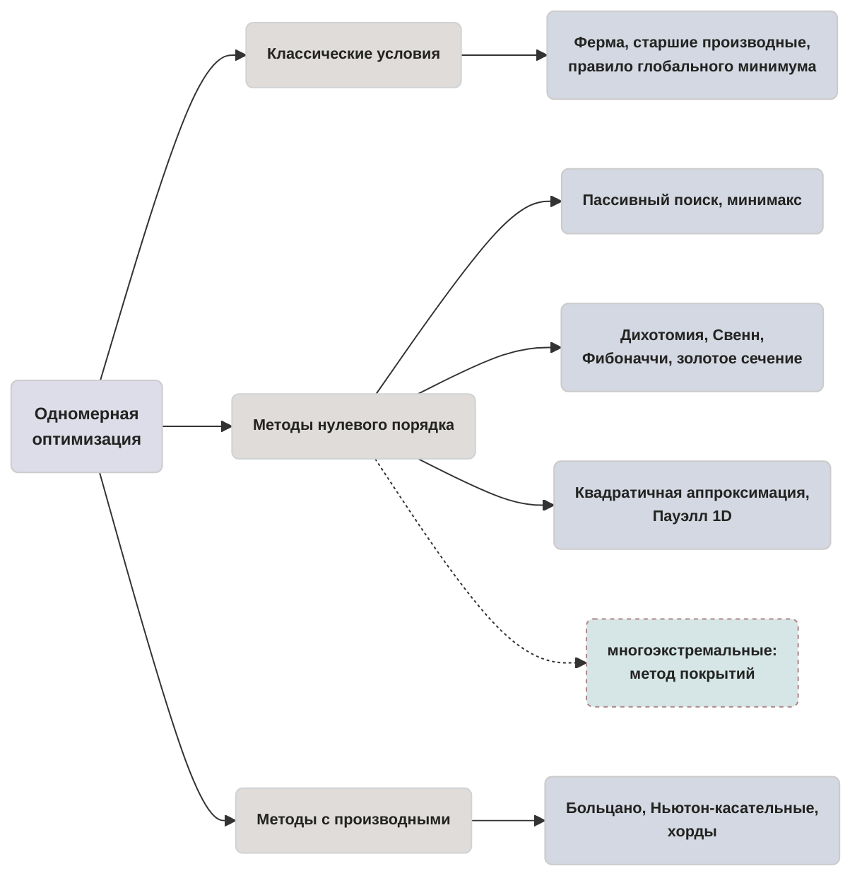

> [!abstract] О чём эта глава
> До сих пор мы работали с линейными моделями и классическими условиями экстремума. Теперь переходим к гладким функциям одной переменной и учимся находить их минимумы на отрезке — сначала аналитически, полным перебором кандидатов, а затем численно, сжимая интервал неопределённости до заданной точности. Вы освоите язык численных методов (порядок, сходимость, обусловленность), сравните цену пассивного поиска, дихотомии, Фибоначчи и золотого сечения, а затем добьёте минимум методами с производными. После этой главы вы будете понимать, почему Ньютон квадратичен, но издалека расходится, и почему золотое сечение дешевле дихотомии.

## 6.1. Классические условия: что такое «минимум» на отрезке

Понятия локального и глобального минимума, строгости и окрестности уже введены в Главе 1. Введение в оптимизацию; здесь напомним одной строкой: точка $x^*$ — *глобальный минимум* $f$ на $X$, если $f(x^*)\leq f(x)$ для всех $x\in X$.

> [!theorem] Теорема 6.1.1 (Вейерштрасс)
> Непрерывная функция на компакте (замкнутом и ограниченном множестве в $\mathbb{R}^n$) достигает на нём и минимума, и максимума.
>
> *Доказательство* приведено в теореме 1.4.1 Главы 1. Введение в оптимизацию; здесь мы используем её как гарантию существования решения на отрезке $[a,b]$.

> [!definition] Определение 6.1.1 (Стационарная точка)
> Точка $\tilde{x}$ называется *стационарной* функции $f$, если $f'(\tilde{x})=0$.

> [!theorem] Теорема 6.1.2 (Ферма, необходимое условие)
> Если $\tilde{x}$ — точка локального экстремума функции $f$, дифференцируемой в $\tilde{x}$, то $f'(\tilde{x})=0$.

*Доказательство.* Пусть $\tilde{x}$ — точка локального минимума (для максимума аналогично). По определению производной:
$$
f'(\tilde{x})=\lim_{h\to 0}\frac{f(\tilde{x}+h)-f(\tilde{x})}{h} \qquad (6.1.1)
$$
При $h>0$ числитель $\geq 0$, значит правый предел $\geq 0$; при $h<0$ числитель $\geq 0$, знаменатель $<0$, значит левый предел $\leq 0$. Поскольку производная существует, оба предела равны $f'(\tilde{x})$, откуда $f'(\tilde{x})=0$. $\blacksquare$

> [!tip] Концептуальная аналогия: горизонталь на перевале
> Горизонтальная касательная бывает и на вершине холма, и на дне долины, и на «полке»-седле, где функция идёт ровно, а потом снова вниз. Поэтому условие $f'=0$ необходимо, но не достаточно: оно лишь отбирает *кандидаты* — стационарные точки.

> [!theorem] Теорема 6.1.3 (Необходимое условие 2-го порядка)
> Если $\tilde{x}$ — точка локального минимума дважды дифференцируемой функции $f$, то $f''(\tilde{x})\geq 0$.

*Доказательство.* Разложим $f$ по Тейлору: $f(\tilde{x}+h)=f(\tilde{x})+f'(\tilde{x})h+\frac{1}{2}f''(\tilde{x})h^2+o(h^2)$. По теореме Ферма $f'(\tilde{x})=0$, поэтому $f(\tilde{x}+h)-f(\tilde{x})=\frac{1}{2}f''(\tilde{x})h^2+o(h^2)$. Если бы $f''(\tilde{x})<0$, то при малых $h$ разность была бы отрицательна при $h\neq 0$, что противоречит локальному минимуму. $\blacksquare$

> [!theorem] Теорема 6.1.4 (Достаточное условие 2-го порядка)
> Пусть $f$ дважды непрерывно дифференцируема, $f'(\tilde{x})=0$. Тогда:
> - если $f''(\tilde{x})>0$, то $\tilde{x}$ — точка строгого локального минимума;
> - если $f''(\tilde{x})<0$, то $\tilde{x}$ — точка строгого локального максимума;
> - если $f''(\tilde{x})=0$, тест молчит — экстремум может быть, а может и не быть.

*Доказательство.* Из разложения Тейлора $f(\tilde{x}+h)-f(\tilde{x})=\frac{1}{2}f''(\tilde{x})h^2+o(h^2)$. При $f''(\tilde{x})>0$ и достаточно малых $h$ правая часть положительна при $h\neq 0$, откуда строгий минимум. Случай $f''(\tilde{x})<0$ разбирается аналогично. $\blacksquare$

> [!theorem] Теорема 6.1.5 (Условия старших порядков, скетч)
> Пусть $f$ имеет в $\tilde{x}$ производные до порядка $n$ включительно, причём $f'(\tilde{x})=\dots=f^{(n-1)}(\tilde{x})=0$, а $f^{(n)}(\tilde{x})\neq 0$. Тогда:
> - если $n$ чётно и $f^{(n)}(\tilde{x})>0$ — строгий локальный минимум;
> - если $n$ чётно и $f^{(n)}(\tilde{x})<0$ — строгий локальный максимум;
> - если $n$ нечётно — экстремума нет.

*Доказательство (скетч).* Разложение Тейлора даёт $f(\tilde{x}+h)-f(\tilde{x})=\frac{f^{(n)}(\tilde{x})}{n!}h^n+o(h^n)$. При чётном $n$ знак $h^n$ не зависит от знака $h$, и экстремум определяется знаком $f^{(n)}(\tilde{x})$. При нечётном $n$ знак $h^n$ меняется с $h$, поэтому разность меняет знак — экстремума нет. $\blacksquare$

**Правило поиска глобального минимума на $[a,b]$.**
1. Найти все *стационарные точки*: где $f'(x)=0$.
2. Найти все *точки разрыва* самой функции $f$.
3. Найти все *точки разрыва производной* $f'$.
4. Вычислить значения $f$ во всех найденных точках, лежащих внутри $(a,b)$, и на *границах* $f(a)$, $f(b)$.
5. Наименьшее из этих значений — глобальный минимум; наибольшее — глобальный максимум.

> [!warning] Правило включает точки, где производной НЕТ
> Контрпример: $f(x)=|x|$ на $[-1,1]$. Стационарных точек нет, но минимум достигается в $x=0$, где производная не существует. Правило из пяти пунктов эту точку ловит через пункт 3.

**Разобранный пример.** Исследовать $f(x)=|x^2-1|$ на $[-2,2]$.

*Шаг 1.* Стационарные точки: внутри $(-1,1)$ имеем $f(x)=1-x^2$, $f'(x)=-2x=0\Rightarrow x=0$. Вне $[-1,1]$ имеем $f(x)=x^2-1$, $f'(x)=2x=0\Rightarrow x=0$ (не попадает). Единственная стационарная точка $x=0$, $f(0)=1$.

*Шаг 2.* Точки разрыва $f$: их нет, функция непрерывна.

*Шаг 3.* Точки разрыва $f'$: в $x=\pm 1$ производная не существует (излом). $f(\pm 1)=0$.

*Шаг 4.* Границы: $f(-2)=f(2)=|4-1|=3$. Собираем кандидатов: $x=0$ ($f=1$), $x=\pm 1$ ($f=0$), $x=\pm 2$ ($f=3$).

*Шаг 5.* Глобальный минимум $f=0$ в $x=\pm 1$; глобальный максимум $f=3$ в $x=\pm 2$; локальный максимум $f(0)=1$.

> [!img] №1: две панели
> ЛЕВАЯ ПАНЕЛЬ: график функции $f(x)=x^3$ на отрезке $[-1,1]$. В нуле — пунктирная горизонтальная касательная, подписанная «$f'(0)=0$». Под графиком подпись: «Стационарная точка, но экстремума нет: функция возрастает». Оси $x$, $y$ подписаны, точки $(-1,-1)$, $(0,0)$, $(1,1)$ отмечены.
> ПРАВАЯ ПАНЕЛЬ: график функции $f(x)=1/x$ на полуинтервале $(0,1]$. Точка $x=1$ отмечена жирной точкой $(1,1)$ (значение достигается), при $x\to 0^+$ функция уходит в $+\infty$. Пунктиром показана нижняя граница $y=1$. Подпись: «$\inf=1$, не достигается: множество не замкнуто, теорема Вейерштрасса не работает». Оси подписаны.

## 6.2. Язык численных методов: порядок, сходимость, останов

Аналитические методы требуют явного решения уравнений, что возможно лишь в редких случаях. В реальных задачах применяют численные методы, строящие последовательность приближений $x^{(k)}\to x^*$.

> [!definition] Определение 6.2.1 (Порядок метода)
> Численный метод называется методом *нулевого порядка*, если для вычисления очередного приближения используются только значения функции. Метод *первого порядка* использует также первые производные (градиент). Метод *второго порядка* — ещё и вторые производные.

> [!tip] Концептуальная аналогия: три поколения разведчиков
> Представьте, что вы ищете самую низкую точку долины в тумане. *Нулевой порядок* — разведчик щупает высоту тростью в соседних точках. *Первый порядок* — чувствует уклон под подошвой. *Второй порядок* — держит карту кривизны местности. С ростом порядка растёт объём информации на шаг, но и стоимость каждого шага.

> [!definition] Определение 6.2.2 (Пассивные и последовательные методы)
> В *пассивном* методе координаты всех точек экспериментов $x^{(1)},\dots,x^{(n)}$ задаются заранее, до начала вычислений. В *последовательном* методе каждая следующая точка $x^{(k+1)}$ выбирается после анализа результатов в точках $x^{(0)},\dots,x^{(k)}$.

> [!definition] Определение 6.2.3 (Конечношаговые и бесконечношаговые методы)
> Метод называется *конечношаговым*, если точка минимума находится за конечное число шагов. Метод *бесконечношаговый* строит сходящуюся последовательность $x^{(k)}\to x^*$.

> [!definition] Определение 6.2.4 (Минимизирующая последовательность и скорости сходимости)
> Последовательность $\{x^{(k)}\}$ называется *минимизирующей* (релаксирующей), если $f(x^{(0)})>f(x^{(1)})>f(x^{(2)})>\dots$
>
> Метод сходится *линейно*, если $\|x^{(k+1)}-x^*\|<q\|x^{(k)}-x^*\|$ с $q\in(0,1)$. Метод сходится *сверхлинейно*, если $\|x^{(k+1)}-x^*\|<q_{k+1}\|x^{(k)}-x^*\|$ с $q_{k+1}\to 0$. Метод сходится *квадратично*, если $\|x^{(k+1)}-x^*\|\leq c\|x^{(k)}-x^*\|^2$.

**Условия останова.** Вычислительный процесс останавливают при выполнении одного из наборов условий:

| Абсолютная форма | Относительная ($\delta$-) форма |
|---|---|
| $\|x^{(k+1)}-x^{(k)}\|\leq \varepsilon_1$ | $\|x^{(k+1)}-x^{(k)}\|\leq \delta_1(1+\|x^{(k+1)}\|)$ |
| $\|f(x^{(k+1)})-f(x^{(k)})\|\leq \varepsilon_2$ | $\|f(x^{(k+1)})-f(x^{(k)})\|\leq \delta_2(1+\|f(x^{(k+1)})\|)$ |
| $\|f'(x^{(k+1)})\|\leq \varepsilon_3$ | $\|f'(x^{(k+1)})\|\leq \delta_3(1+\|f'(x^{(k+1)})\|)$ |

> [!definition] Определение 6.2.5 (Обусловленность)
> Пусть $L_\delta=\{x\colon f(x)=f(x^*)+\delta\}$ — линия уровня. Число обусловленности $\mu=\lim_{\delta\to 0}\frac{\sup\|x-x^*\|^2}{\inf\|x-x^*\|^2}$, где sup и inf берутся по $x\in L_\delta$. Для квадратичной функции $f(x)=c^T x+\frac{1}{2}x^T H x$ с $H>0$ имеем $\mu=\lambda_{\max}/\lambda_{\min}$. Если $\mu\gg 1$, линии уровня вытянуты — задача *плохо обусловлена* (овраг). Если $\mu\approx 1$, линии уровня близки к окружностям — задача *хорошо обусловлена*.

> [!note] Мостик
> Полное развитие теории обусловленности и оврагов — в Главе 7. Численные методы безусловной оптимизации. Здесь обусловленность упоминается только как анонс: она определяет, насколько быстро методы спуска сходятся к минимуму.

> [!warning] Малый шаг $\neq$ близость к минимуму
> Условие $\|x^{(k+1)}-x^{(k)}\|\leq \varepsilon_1$ может сработать на «полке» функции раньше, чем достигнут минимум. Кроме того, малый градиент не гарантирует близости к $x^*$: функции $f$ и $10^{-6}f$ имеют один и тот же минимум, но их градиенты отличаются в миллион раз.

> [!img] №2: схождение последовательности
> График унимодальной функции $f(x)$ с минимумом в $x^*$. На оси $x$ отмечены точки $x^{(0)}, x^{(1)}, x^{(2)}, x^{(3)}$, сходящиеся к $x^*$. От каждой точки вниз опущен вертикальный отрезок-«ошибка» $\|x^{(k)}-x^*\|$, длины которых убывают как геометрическая прогрессия. Справа — мини-ось с подписью «$q\approx 0.5$», иллюстрирующая линейную скорость сходимости. Оси $x$, $f(x)$ подписаны, точка $x^*$ выделена.

> [!note] Мостик к предыдущим главам
> Симплекс-метод и распределительный метод в транспортных задачах — конечношаговые (Глава 3. Симплекс-метод и его модификации, Глава 4. Транспортные задачи линейного программирования). Всё, что дальше в этой главе, — бесконечношаговые методы: они строят сходящуюся последовательность приближений.

## 6.3. Пассивный поиск и принцип минимакса

> [!definition] Определение 6.3.1 (Унимодальная функция)
> Функция $f(x)$ на $(a,b)$ называется *унимодальной*, если она имеет единственный минимум $x^*$ и монотонно убывает при $x<x^*$ и монотонно возрастает при $x>x^*$.

**Свойство пары экспериментов.** Для унимодальной функции любая пара точек $x_1<x_2$ позволяет отбросить часть интервала:
- если $f(x_1)<f(x_2)$, то $x^*\in(a,x_2)$ — отбрасываем $[x_2,b]$;
- если $f(x_1)>f(x_2)$, то $x^*\in(x_1,b)$ — отбрасываем $[a,x_1]$;
- если $f(x_1)=f(x_2)$, то $x^*\in(x_1,x_2)$ — отбрасываем оба хвоста.

> [!definition] Определение 6.3.2 (Пессимистическая оценка и минимаксная стратегия)
> При $n$ экспериментах $x_1<x_2<\dots<x_n$ на $[a,b]$ (с $x_0=a$, $x_{n+1}=b$) пессимистическая оценка длины интервала неопределённости — это $L_n=\max_{1\leq k\leq n} l_n(x_1,\dots,x_n,k)$, где $l_n=x_{k+1}-x_{k-1}$ — длина $k$-го интервала после отбрасывания. *Минимаксная стратегия* — это стратегия, минимизирующая $L_n$: $\hat{L}_n=\inf_{x_1<\dots<x_n}\max_k l_n$.

**Разобранный пример.** Вычислить $L_3$ для $x_1=0.2$, $x_2=0.45$, $x_3=0.8$ на $[0,1]$.

$x_0=0$, $x_4=1$. Кандидаты: $l_1=x_2-x_0=0.45$, $l_2=x_3-x_1=0.6$, $l_3=x_4-x_2=0.55$. Пессимистическая оценка $L_3=\max\{0.45; 0.6; 0.55\}=0.6$.

**Значения минимаксных оценок.** $\hat{L}_1=1$; $\hat{L}_2=(1+\varepsilon)/2$; для чётных $n$:
$$
\hat{L}_n=\frac{1+\varepsilon}{n/2+1} \qquad (6.3.1)
$$
где $\varepsilon$ — предельная точность различимости $f(x_1)$ и $f(x_2)$. Разность $\hat{L}_n-\hat{L}_{n+1}=\varepsilon/(n/2+1)$ показывает, что *нечётное число экспериментов невыгодно*: тот же результат даёт меньшее число шагов.

> [!warning] $\varepsilon$ — это не точность ответа
> В пассивном поиске $\varepsilon$ — разрешимость пары значений $f$, а не итоговая точность локализации $x^*$. Пассивный метод проигрывает последовательным экспоненциально (см. таблицу А в §6.4).

> [!img] №3: три панели исходов пары экспериментов
> ТРИ ПАНЕЛИ РЯДОМ на унимодальной функции $f(x)$ с минимумом $x^*$.
> ПАНЕЛЬ 1: $f(x_1)<f(x_2)$ — точки $x_1<x_2$, штриховкой отброшен правый хвост $[x_2,b]$, подпись «отбрасываем $[x_2,b]$».
> ПАНЕЛЬ 2: $f(x_1)>f(x_2)$ — штриховкой отброшен левый хвост $[a,x_1]$, подпись «отбрасываем $[a,x_1]$».
> ПАНЕЛЬ 3: $f(x_1)=f(x_2)$ — штриховкой отброшены оба хвоста $[a,x_1]$ и $[x_2,b]$, середина $[x_1,x_2]$ оставлена, подпись «отбрасываем оба хвоста».
> На всех панелях оси $x$, $f(x)$ подписаны, точки $x_1$, $x_2$ отмечены, стрелками показано направление отбрасывания.

## 6.4. Последовательные прямые методы (нулевой порядок)

Все методы этого параграфа — нулевого порядка, последовательные, для унимодальных функций.

**Метод дихотомии.** На каждой итерации в середину текущего интервала ставится пара точек на расстоянии $\varepsilon$ друг от друга. По сравнению значений функция отбрасывается половина интервала. После $n$ экспериментов (чётное $n$):
$$
\hat{L}_n=2^{-n/2}+(1-2^{-n/2})\frac{\varepsilon}{2} \qquad (6.4.1)
$$

**Метод Свенна (грубый поиск).** Начальная точка $x_0$ и шаг $\Delta$. Формула расширения: $x_{k+1}=x_k+2^k\Delta$, $k=0,1,2,\dots$. Эксперименты продолжаются, пока функция убывает; как только она начала расти — интервал локализации найден. Назначение Свенна — поймать интервал унимодальности, а не добиться точности.

**Метод Фибоначчи.** Числа Фибоначчи: $F_0=F_1=1$, $F_k=F_{k-1}+F_{k-2}$. Рекуррента для длин интервалов: $\hat{L}_{j-1}=\hat{L}_j+\hat{L}_{j+1}$. Развёртывая цепочку $\hat{L}_{n-1}=2\hat{L}_n-\varepsilon$, $\hat{L}_{n-2}=3\hat{L}_n-\varepsilon$, $\dots$, $\hat{L}_{n-k}=F_{k+1}\hat{L}_n-F_{k-1}\varepsilon$, получаем итоговую оценку:
$$
\hat{L}_n=\frac{1}{F_n}+\frac{F_{n-2}}{F_n}\varepsilon \qquad (6.4.2)
$$
Число экспериментов $n$ выбирается заранее из условия
$$
F_{n+1}<\frac{b_0-a_0}{\varepsilon}\leq F_{n+2} \qquad (6.4.3)
$$

**Пример.** При $(b_0-a_0)/\varepsilon=10$ имеем $F_5=8<10\leq F_6=13$, значит $n+1=6$, $n=4$ (четыре эксперимента).

**Метод золотого сечения.** Отношение длин $\tau=\hat{L}_j/\hat{L}_{j-1}$ постоянно. Из условия $\hat{L}_{j-1}=\hat{L}_j+\hat{L}_{j+1}$ и постоянства отношения получаем $1=\tau+\tau^2$, откуда
$$
\tau=\frac{\sqrt{5}-1}{2}\approx 0.618, \quad \tau^2\approx 0.382 \qquad (6.4.4)
$$
После отбрасывания части интервала оставшаяся метка снова стоит в пропорциональной точке — поэтому на каждом шаге достаточно *одного нового эксперимента*. Итоговая оценка: $\hat{L}_n=\tau^{n-1}$. Остановку можно производить в любой момент.

> [!tip] Концептуальная аналогия: наследник интервала
> В золотом сечении один эксперимент всегда переходит в следующую итерацию *наследством* — поэтому оно дешевле дихотомии, которая каждый раз тратит пару с нуля.

**Разобранный пример.** Две итерации золотого сечения на $[0,1]$.

*Итерация 1.* Точки $y_1=0.382$, $z_1=0.618$.
- Ветвь $f(y_1)<f(z_1)$: отбрасываем $[0.618,1]$, новый интервал $[0,0.618]$, унаследованная точка $0.382$, новая $0.236$.
- Ветвь $f(y_1)>f(z_1)$: отбрасываем $[0,0.382]$, новый интервал $[0.382,1]$, унаследованная точка $0.618$, новая $0.764$.

**Таблица А. Сравнение методов одномерного поиска.**

| Метод | Число экспериментов для сужения $1\to 0.01$ | Точность за 10 экспериментов |
|---|---|---|
| Пассивный (равномерный) | 198 | 20% |
| Дихотомия | 14 | 3.1% |
| Фибоначчи | 11 | 1.1% |
| Золотое сечение | 11 | 1.3% |

> [!warning] Ограничения методов нулевого порядка
> Фибоначчи требует зафиксировать $n$ заранее (нельзя остановиться «по ходу»). Золотое сечение асимптотически чуть хуже Фибоначчи, но свободнее. Дихотомия тратит пару экспериментов на один бит информации и зависит от $\varepsilon$. Свенн — прелюдия, а не метод точности.

**Дополнение со звёздочкой: метод покрытий.** Для многоэкстремальных функций отрезок $[a,b]$ разбивается на покрывающие подотрезки, на каждом из которых функция предполагается унимодальной и применяется один из методов выше. Из локальных минимумов выбирается наименьший. Комбинаторная цена растёт с требуемой точностью, и метод не гарантирует нахождение глобального минимума, если покрытие слишком грубое. *Кубическая интерполяция* использует также производные и даёт ещё более быструю сходимость, чем квадратичная, но требует больше информации на шаг.

> [!img] №4: четыре панели расстановки точек
> ЧЕТЫРЕ ПАНЕЛИ РЯДОМ, на каждой — отрезок $[0,1]$ с отмеченными точками экспериментов.
> ПАНЕЛЬ 1: «Пассивный поиск» — равномерная сетка из 4 точек: 0.2, 0.4, 0.6, 0.8.
> ПАНЕЛЬ 2: «Дихотомия» — пара точек у центра $0.5\pm\varepsilon/2$, затем новая пара в оставшейся половине.
> ПАНЕЛЬ 3: «Золотое сечение» — точки в пропорциях $\tau\approx 0.618$ и $1-\tau\approx 0.382$ от концов.
> ПАНЕЛЬ 4: «Фибоначчи» — асимметричная пара $F_{n-1}/F_n$, $F_{n-2}/F_n$ от концов.
> Под всеми панелями — строки таблицы А. Оси подписаны.

> [!img] №5: две итерации золотого сечения
> ДВЕ ПАНЕЛИ РЯДОМ на отрезке $[0,1]$.
> ПАНЕЛЬ 1 (итерация 1): точки 0.382 и 0.618, заштрихован отброшенный отрезок $[0.618,1]$, подпись «$f(0.382)<f(0.618)$».
> ПАНЕЛЬ 2 (итерация 2): интервал $[0,0.618]$ с унаследованной точкой 0.382 (отмечена жирной точкой с подписью «наследник») и новой точкой 0.236. Оси с числами обязательны.

## 6.5. Аппроксимационные методы: квадратичная, кубическая, Пауэлл 1D

**Квадратичная аппроксимация.** По трём точкам $x_1,x_2,x_3$ строится парабола $\varphi(x)=a_0+a_1(x-x_1)+a_2(x-x_1)(x-x_2)$, её минимум принимается за оценку $x^*$:
$$
a_0=f_1, \quad a_1=\frac{f_2-f_1}{x_2-x_1}, \quad a_2=\frac{f_3-f_1}{(x_3-x_1)(x_3-x_2)}-\frac{f_2-f_1}{(x_2-x_1)(x_3-x_2)} \qquad (6.5.1)
$$
$$
\tilde{x}=\frac{x_1+x_2}{2}-\frac{a_1}{2a_2} \qquad (6.5.2)
$$
Скорость сходимости — сверхлинейная. Требования: непрерывная унимодальная достаточно гладкая $f$.

**Разобранный пример.** $f(x)=x^4-2x^2$ по точкам $x_1=0.5$ ($f=-0.4375$), $x_2=1$ ($f=-1$), $x_3=2$ ($f=8$).

$a_1=(-1-(-0.4375))/(1-0.5)=-1.125$.
$a_2=(8-(-0.4375))/((2-0.5)(2-1))-(-1-(-0.4375))/((1-0.5)(2-1))=5.625-(-1.125)=6.75$.
$\tilde{x}=(0.5+1)/2-(-1.125)/(2\cdot 6.75)=0.75+0.0833\approx 0.8333$.
$f(\tilde{x})\approx -0.9066$ против истинного $f(x^*)=-1$ в $x^*=1$. Одна итерация не точна на неквадратичной $f$.

*Замечание.* На квадратичной $f$ аппроксимация точна за одну итерацию — это её идеальная форма.

**Метод Пауэлла 1D.** Задаётся начальная точка $x_1$ и шаг $\Delta x$. Вычисляются $f(x_1)$, $f(x_2)=f(x_1+\Delta x)$, $f(x_3)$ (выбор направления — по убыванию). По трём точкам строится квадратичная аппроксимация и её минимум $\tilde{x}$. Если $|f_{\min}-f(\tilde{x})|$ и $|\tilde{x}-x_{\min}|$ малы — стоп. Иначе выбираются две лучшие точки и две по обе стороны от них, и процедура повторяется.

> [!warning] Проверка $a_2>0$
> Если $a_2\leq 0$, парабола «открыта вниз» — $\tilde{x}$ указывает на максимум или уходит за интервал. Обязательно проверять $a_2>0$ и $\tilde{x}\in[\min x_i, \max x_i]$, иначе откат к шагу дихотомии.

> [!img] №6: квадратичная аппроксимация
> График $f(x)=x^4-2x^2$ на $[0.4,2.1]$. Три жирные точки: $(0.5,-0.4375)$, $(1,-1)$, $(2,8)$. Пунктиром — парабола $\varphi(x)$, проходящая через них. Отмечены $\tilde{x}\approx 0.833$ (минимум параболы) и истинный $x^*=1$ (минимум $f$). Подпись: «Одна итерация квадратичной аппроксимации: приближение, а не попадание». Оси $x$, $f(x)$ подписаны.

## 6.6. Методы с производными: Больцано, Ньютон-касательные, хорды

Эти методы используют информацию о $f'(x)$ и потому сходятся быстрее, но требуют дифференцируемости.

**Метод Больцано (деление пополам по знаку производной).** На каждой итерации вычисляется $f'$ в середине текущего интервала. По знаку $f'$ отбрасывается половина интервала. Условие останова: $|f'(x)|\leq \varepsilon$. Интервал halving каждый шаг.

**Метод касательных Ньютона.** Функция строго выпукла. Уравнение $f'(x)=0$ решается итерационно: из текущей точки $\tilde{x}_k$ к графику $f'(x)$ проводится касательная, и её пересечение с осью $x$ даёт следующее приближение:
$$
\tilde{x}_{k+1}=\tilde{x}_k-\frac{f'(\tilde{x}_k)}{f''(\tilde{x}_k)}, \quad k=0,1,2,\dots \qquad (6.6.1)
$$
Если аналитические производные недоступны, используются численные с базой $g$:
$$
f'(x)\approx \frac{f(x+g)-f(x-g)}{2g}, \quad f''(x)\approx \frac{f(x+2g)-2f(x)+f(x-2g)}{4g^2} \qquad (6.6.2)
$$

> [!tip] Концептуальная аналогия: пристрелка — по таблицам и по попаданиям
> Ньютон стреляет по баллистическим таблицам — знает кривизну $f''$. Хорды пристреливаются по двум предыдущим попаданиям, таблиц не требуя. Обе схемы дают поправку к прицелу, но цена выстрела разная.

**Метод хорд.** Секущая к $f'$ по двум точкам. Условие сходимости: $f'(x_{01})\cdot f'(x_{02})>0$. Первая итерация:
$$
\tilde{x}_1=x_{01}-\frac{f'(x_{01})(x_{02}-x_{01})}{f'(x_{02})-f'(x_{01})} \qquad (6.6.3)
$$
Далее, если $f'(\tilde{x}_2)>0$, аппроксимация проводится по точкам 3 и 4, иначе — по 1 и 4. Условие останова: $|f'(\tilde{x}_k)|\leq \varepsilon$. Универсальнее касательных: не требует $f''$.

**Разобранный пример.** $f(x)=x^4-2x^2$, минимум $x^*=1$. $f'(x)=4x^3-4x$, $f''(x)=12x^2-4$.

*Ньютон из $x_0=2$.* $f'(2)=24$, $f''(2)=44$.
$x_1=2-24/44=16/11\approx 1.4545$. Ошибка $e_1=0.4545$.
$x_2\approx 1.1511$. Ошибка $e_2=0.1511$.
$x_3\approx 1.0253$. Ошибка $e_3=0.0253$.
Цепочка ошибок $0.4545\to 0.1511\to 0.0253$ демонстрирует квадратичность: каждая примерно равна квадрату предыдущей с некоторым множителем.

> [!warning] Ньютон издалека расходится
> Если начальная точка выбрана далеко от $x^*$, метод может уйти в бесконечность, попасть в максимум или зациклиться (при $f''\approx 0$). Хорды без однозначности знака $f'$ на концах уводят секущую вне окрестности. Численная производная: $g$ мала — катастрофа вычитания близких чисел, $g$ велика — ошибка усечения.

> [!img] №7: две панели — Ньютон и хорды
> ДВЕ ПАНЕЛИ РЯДОМ.
> ЛЕВАЯ ПАНЕЛЬ: «Ньютон издалека». График $f'(x)$ с корнем $x^*$. Из далёкой точки $x_0$ проведена касательная, её пересечение с осью $x$ даёт $\tilde{x}_1$, которое оказалось далеко от $x^*$ (стрелка-прыжок через корень). Из близкой точки касательная даёт короткий шаг к $x^*$.
> ПРАВАЯ ПАНЕЛЬ: «Метод хорд». Та же кривая $f'(x)$, две точки $x_{01}$ и $x_{02}$ с одинаковым знаком $f'$ (оба положительны). Через них проведена секущая, её пересечение с осью $x$ даёт $\tilde{x}_1$. Подпись: «Условие $f'(x_{01})\cdot f'(x_{02})>0$». Оси подписаны.

## 6.7. Практикум

> [!question] Задачи
> 1. Правило глобального минимума: $f(x)=|x^2-1|$ на $[-2,2]$ — провести по всем пяти пунктам правила, указать global min/max и локальный максимум.
> 2. Старшие порядки: $f=x^4$ и $g=x^5$ в нуле; почему тест 2-го порядка молчит.
> 3. Пассивный поиск: вычислить $L_3$ для $x_1=0.2$, $x_2=0.45$, $x_3=0.8$ на $[0,1]$.
> 4. Золотое сечение: вторая итерация на $[0,1]$ для ветви $f(y_1)>f(z_1)$ — указать интервал, унаследованную и новую точки.
> 5. Фибоначчи: сколько экспериментов для сужения интервала в 50 раз?
> 6. Ньютон: две итерации по $f'$ для $f=x^4-2x^2$ из $x_0=2$; объяснить квадратичную сходимость по ошибкам.

> [!success] Ответы
> 1. $\min f=0$ в $x=\pm 1$ (точки разрыва $f'$); $\max f=3$ в $x=\pm 2$ (границы); локальный максимум $f(0)=1$ (стационарная точка).
> 2. $f^{(4)}(0)=24>0$, $n=4$ чётно — строгий минимум. $g^{(5)}(0)=120\neq 0$, $n=5$ нечётно — экстремума нет. $f''(0)=g''(0)=0$ — тест 2-го порядка молчит, гессиан вырожден.
> 3. $L_3=\max\{0.45; 0.6; 0.55\}=0.6$.
> 4. Интервал $[0.382, 1]$; унаследованная точка $0.618$; новая точка $0.764$.
> 5. $F_8=34<50\leq F_9=55 \Rightarrow n=7$ экспериментов.
> 6. $x_1\approx 1.4545$, $x_2\approx 1.1511$; ошибки $e_1=0.4545\to e_2=0.1511\to e_3=0.0253$ (при $x_3\approx 1.0253$): $e_{k+1}\approx C\cdot e_k^2$ — квадратичная сходимость.

---

Мы закончили с одномерной оптимизацией — от классических условий Ферма до квадратичного Ньютона. Но все эти методы работают на линии. В следующей главе мы выходим на плоскость и в многомерные пространства: градиент и гессиан заменяют пробы и наклоны, а методы спуска превращают одномерный поиск в подпрограмму выбора шага.

> [!quote] Эпиграф
> «Цель вычислений — понимание, а не числа».
> — *Ричард Хемминг*

Связанные разделы: [[Глава 1. Введение в оптимизацию]] (Вейерштрасс, компактность). [[Глава 3. Симплекс-метод и его модификации]] (контраст конечношаговости). [[Глава 4. Транспортные задачи линейного программирования]] (распределительный метод — тоже конечношаговый). [[Глава 7. Численные методы безусловной оптимизации]] (полное развитие $\mu$, оврагов, градиентных методов).
