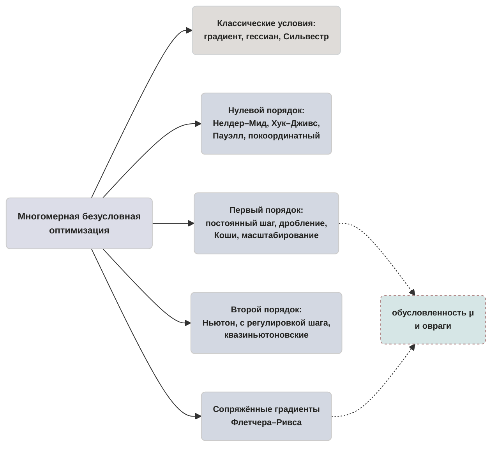

> [!abstract] О чём эта глава
> До сих пор мы работали с линейными моделями и функциями одной переменной. Теперь выходим в многомерные пространства: вы научитесь находить и классифицировать стационарные точки по градиенту и сигнатуре гессиана, читать число обусловленности $\mu$ и предсказывать зигзаг в овраге, проводить руками итерации Нелдера–Мида, Хука–Дживса, Пауэлла, градиентного спуска с постоянным/дробящимся/наискорейшим шагом, Ньютона и Флетчера–Ривса. После этой главы вы будете понимать, почему сопряжённые градиенты дают скорость второго порядка, оставаясь методом первого, и выбирать метод по таблице сравнения.

## 7.1. Классические условия: градиент, гессиан, Сильвестр

Функция $f\colon X\subset\mathbb{R}^n\to\mathbb{R}$. Понятия локального и глобального минимума, выпуклости и равенства «локальный = глобальный» для выпуклых функций уже введены в Главе 1. Введение в оптимизацию; здесь мы строим аналитический аппарат.

> [!definition] Определение 7.1.1 (Градиент)
> *Градиент* функции $f$ в точке $x$ — вектор-столбец первых частных производных:
> $$\nabla f(x) = \begin{pmatrix} \frac{\partial f}{\partial x_1} \\ \vdots \\ \frac{\partial f}{\partial x_n} \end{pmatrix} \qquad (7.1.1)$$

> [!definition] Определение 7.1.2 (Гессиан)
> *Гессиан* — матрица вторых частных производных:
> $$\nabla^2 f(x) = \begin{pmatrix} \frac{\partial^2 f}{\partial x_1^2} & \cdots & \frac{\partial^2 f}{\partial x_1 \partial x_n} \\ \vdots & \ddots & \vdots \\ \frac{\partial^2 f}{\partial x_n \partial x_1} & \cdots & \frac{\partial^2 f}{\partial x_n^2} \end{pmatrix} \qquad (7.1.2)$$
> Для дважды непрерывно дифференцируемых функций гессиан симметричен.

> [!definition] Определение 7.1.3 (Квадратичная форма и знакоопределённость)
> Квадратичная форма $Q(h)=h^T A h$ (где $A$ — симметричная матрица) называется:
> - *положительно определённой*, если $Q(h)>0$ при всех $h\neq 0$;
> - *отрицательно определённой*, если $Q(h)<0$ при всех $h\neq 0$;
> - *знаконеопределённой*, если принимает значения обоих знаков;
> - *вырожденной*, если $Q(h)=0$ при некотором $h\neq 0$.

> [!theorem] Теорема 7.1.1 (Необходимое условие)
> Если $x^*$ — точка локального экстремума и $f$ дифференцируема в $x^*$, то $\nabla f(x^*)=0$.

*Доказательство.* Фиксируем любое направление $e$ и рассмотрим функцию одной переменной $\varphi(t)=f(x^*+te)$. Если $x^*$ — экстремум $f$, то $t=0$ — экстремум $\varphi$. По теореме Ферма $\varphi'(0)=0$. Но $\varphi'(0)=\langle \nabla f(x^*), e\rangle$. Поскольку это верно для любого $e$, получаем $\nabla f(x^*)=0$. $\blacksquare$

> [!theorem] Теорема 7.1.2 (Достаточное условие через гессиан)
> Пусть $\nabla f(x^*)=0$ и $f$ дважды непрерывно дифференцируема. Тогда:
> - если $\nabla^2 f(x^*)$ положительно определена — $x^*$ точка строгого локального минимума;
> - если отрицательно определена — строгого локального максимума;
> - если знаконеопределена — $x^*$ не является экстремумом (седловая точка);
> - если вырождена — тест молчит.

*Доказательство.* Разложение Тейлора: $f(x^*+h)=f(x^*)+\langle \nabla f(x^*), h\rangle + \frac{1}{2}h^T \nabla^2 f(x^*) h + o(\|h\|^2)$. При $\nabla f(x^*)=0$ получаем $f(x^*+h)-f(x^*)=\frac{1}{2}h^T \nabla^2 f(x^*)h + o(\|h\|^2)$. Если гессиан положительно определён, то $h^T \nabla^2 f(x^*)h \geq \lambda_{\min}\|h\|^2$ с $\lambda_{\min}>0$, и при малых $\|h\|$ разность положительна. Остальные случаи разбираются аналогично. $\blacksquare$

**Критерий Сильвестра.** Симметричная матрица $A$ размера $n\times n$ положительно определена тогда и только тогда, когда все её *угловые миноры* (определители верхних левых подматриц) положительны:

$$\Delta_1 = a_{11} > 0, \quad \Delta_2 = \begin{vmatrix} a_{11} & a_{12} \\ a_{21} & a_{22} \end{vmatrix} > 0, \quad \dots, \quad \Delta_n = \det A > 0 \qquad (7.1.3)$$

Матрица отрицательно определена тогда и только тогда, когда угловые миноры знакопеременны, начиная с минуса:

$$\Delta_1 < 0, \quad \Delta_2 > 0, \quad \Delta_3 < 0, \quad \dots \qquad (7.1.4)$$

> [!warning] Три типичные ошибки
> 1. $\nabla f=0$ не обещает экстремум — это может быть седло (см. пример ниже).
> 2. Сильвестр по угловым минорам даёт только *строгую* знакоопределённость. Если $\Delta_n=0$, гессиан вырожден, и тест 2-го порядка молчит. Придётся привлекать старшие производные или прямой анализ знаков.
> 3. Не путайте *угловые* миноры (верхние левые) и *главные* (любые квадратные подматрицы с одинаковыми наборами индексов). Для положительной определённости достаточно угловых; для отрицательной — тоже угловых, но со знакопеременностью.

> [!tip] Концептуальная аналогия: чаша, купол и перевал
> Три судьбы стационарной точки по сигнатуре кривизны. *Чаша* ($x^2+y^2$): гессиан положительно определён — во всех направлениях вверх, это минимум. *Купол* ($-x^2-y^2$): гессиан отрицательно определён — во всех направлениях вниз, это максимум. *Перевал* ($x^2-y^2$): гессиан знаконеопределён — в одних направлениях вверх, в других вниз, это седло.

**Разобранный пример.** Исследовать $f(x,y)=x^3+y^3-3xy$.

*Шаг 1. Стационарные точки.* $\frac{\partial f}{\partial x}=3x^2-3y=0$, $\frac{\partial f}{\partial y}=3y^2-3x=0$. Из первого $y=x^2$, подставляем во второе: $x^4-x=0$, откуда $x(x^3-1)=0$. Точки: $(0,0)$ и $(1,1)$.

*Шаг 2. Гессиан.* $\nabla^2 f = \begin{pmatrix} 6x & -3 \\ -3 & 6y \end{pmatrix}$.

*Шаг 3. Классификация.*
- В точке $(1,1)$: $\nabla^2 f = \begin{pmatrix} 6 & -3 \\ -3 & 6 \end{pmatrix}$. Угловые миноры: $\Delta_1=6>0$, $\Delta_2=36-9=27>0$. Гессиан положительно определён — строгий локальный минимум, $f(1,1)=1+1-3=-1$.
- В точке $(0,0)$: $\nabla^2 f = \begin{pmatrix} 0 & -3 \\ -3 & 0 \end{pmatrix}$. $\Delta_1=0$, $\Delta_2=-9<0$. Гессиан знаконеопределён — седловая точка.

> [!img] №1: три панели поверхностей
> ТРИ ПАНЕЛИ РЯДОМ, у каждой — график поверхности слева и линии уровня справа.
> ПАНЕЛЬ 1: «Чаша» — параболоид $z=x^2+y^2$, минимум в нуле. Линии уровня — концентрические окружности. Под гессианом подпись: «$\Delta_1=2>0$, $\Delta_2=4>0$ — положительно определён».
> ПАНЕЛЬ 2: «Купол» — параболоид $z=-x^2-y^2$, максимум в нуле. Линии уровня — концентрические окружности. Подпись: «$\Delta_1=-2<0$, $\Delta_2=4>0$ — отрицательно определён».
> ПАНЕЛЬ 3: «Перевал» — седло $z=x^2-y^2$. Линии уровня — гиперболы. Подпись: «$\Delta_1=2>0$, $\Delta_2=-4<0$ — знаконеопределён».

> [!img] №2: линии уровня примера
> Линии уровня функции $f(x,y)=x^3+y^3-3xy$. В точке $(0,0)$ — «перекрёсток» уровней, сходящихся крест-накрест (седло). В точке $(1,1)$ — центр концентрических замкнутых овалов (минимум). Точки подписаны, около каждой — значение функции и тип: «$(0,0)$, седло» и «$(1,1)$, минимум, $f=-1$».

> [!note] Мостик
> Градиент и гессиан — топливо всех численных методов главы. Выпуклость и равенство «локальный = глобальный» для выпуклых функций — из [[Глава 1. Введение в оптимизацию]].

## 7.2. Обусловленность и овраги

> [!definition] Определение 7.2.1 (Число обусловленности)
> Пусть $L_\delta=\{x\colon f(x)=f(x^*)+\delta\}$ — линия уровня. Число обусловленности
> $$\mu=\lim_{\delta\to 0}\frac{\sup\|x-x^*\|^2}{\inf\|x-x^*\|^2} \qquad (7.2.1)$$
> где sup и inf берутся по $x\in L_\delta$. Для квадратичной функции $f(x)=c^T x+\frac{1}{2}x^T H x$ с $H>0$ имеем $\mu=\lambda_{\max}/\lambda_{\min}$.

$\mu\geq 1$; $\mu\approx 1$ — линии уровня почти окружности (задача *хорошо обусловлена*); $\mu\gg 1$ — линии уровня вытянуты, задача *плохо обусловлена* (овраг).

> [!definition] Определение 7.2.2 (Овраг)
> *Овраг* — функция с $\mu\gg 1$; градиентные методы зигзагуют поперёк оврага.

Связь со скоростью сходимости: если $m$ и $M$ — оценки снизу и сверху собственных значений гессиана, то

$$q=\frac{M-m}{M+m} \qquad (7.2.2)$$

$q\approx 0$ — быстро, $q\approx 1$ — медленно.

**Разобранный пример.** $f=x_1^2+16x_2^2$. Гессиан $H=\mathrm{diag}(2,32)$, $m=2$, $M=32$, $\mu=16$, $q=30/34=15/17\approx 0.882$. Для стократного уменьшения ошибки функции *по теоретической гарантии* (7.4.2) достаточно $k\geq \ln(0.01)/\ln(15/17)\approx 36.8\Rightarrow 37$ итераций наискорейшего спуска. Фактическая скорость на этом примере выше (см. §7.6).

> [!img] №3: овраг и зигзаг
> Эллипсы уровней $f=x_1^2+16x_2^2$ (соотношение полуосей 4:1). Ломаная Коши с прямыми углами (зигзаг поперёк оврага) с точками $x^{(0)}=(2,2)$, $x^{(1)}\approx(1.8745,-0.0073)$, $x^{(2)}\approx(0.1034,0.1034)$, $\dots$, $x^{(5)}\approx(0,0)$; и двухзвенная траектория сопряжённых направлений до $(0,0)$. Подпись: «$\mu=16$, $q=15/17$». Оси $x_1$, $x_2$ подписаны, точки итераций отмечены номерами.

> [!note] Мостик
> Овраг — причина, по которой появятся масштабирование (§7.4), сопряжённые направления (§7.3) и сопряжённые градиенты (§7.6).

## 7.3. Прямые методы (нулевой порядок)

Методы нулевого порядка используют только значения функции.

**Покоординатный спуск.** Из $x^{(k)}$ минимизируем $f$ по одной координате одномерным методом из Главы 6. Одномерная оптимизация, циклически по $n$; одна внешняя итерация = $n$ одномерных поисков. Сходится при непрерывной дифференцируемости; быстр при слабом взаимодействии переменных, вязнет в овраге. (Градиентный вариант с частными производными — в §7.4.)

**Метод Нелдера–Мида** (симплекс $n+1$ вершин):
1. Упорядочивание $f(x^{(0)})\leq\dots\leq f(x^{(n)})$.
2. Центр тяжести $x^{(c)}=\frac{1}{n}\sum_{i=0}^{n-1}x^{(i)}$.
3. Отражение $u=x^{(n)}+(1+\theta)(x^{(c)}-x^{(n)})$, $\theta=1$.
4. Если $f(x^{(0)})\leq f(u)\leq f(x^{(n-1)})$: заменить $x^{(n)}$ на $u$.
5. Если $f(u)<f(x^{(0)})$: растяжение $\theta=2$, принять лучшую из $u$ и растянутой.
6. Если $f(u)>f(x^{(n-1)})$: сжатие $\gamma=0.5$:
   - $\omega=x^{(n)}+(1+\gamma)(x^{(c)}-x^{(n)})$, если $f(u)\leq f(x^{(n)})$;
   - $\omega=x^{(n)}+(1-\gamma)(x^{(c)}-x^{(n)})$, если $f(u)>f(x^{(n)})$;
   - если $f(\omega)<\min\{f(u),f(x^{(n)})\}$ — принять $\omega$, иначе глобальное сжатие $x^{(i)}:=x^{(i)}+\frac{1}{2}(x^{(0)}-x^{(i)})$.
7. Останов: $\left[\frac{1}{n}\sum(f(x^{(i)})-f(x^{(0)}))^2\right]^{1/2}\leq \varepsilon$.
8. Начальный симплекс: $r=\ell\frac{\sqrt{n+1}-1}{n\sqrt{2}}$, $s=\ell\frac{\sqrt{n+1}+n-1}{n\sqrt{2}}$, где $\ell$ — длина ребра.
9. Перезапуск: если вершина не исключается $M=1.65n+0.05n^2$ итераций — новый правильный симплекс вокруг лучшей вершины.

**Метод Хука–Дживса.** Исследующий поиск (пробные шаги $\pm\Delta x_j$ по координатам из базовой точки) + поиск по образцу $x_{\text{вр}}=x^{(k)}+(x^{(k)}-x^{(k-1)})$; при неудаче ИП уменьшить шаги $\Delta x_j/\alpha$; останов $\|\Delta x\|\leq \varepsilon$.

**Метод сопряжённых направлений Пауэлла.** $C$-сопряжённость $d^{(i)T}Hd^{(j)}=0$ ($i\neq j$); на $k$-й итерации $n+1$ одномерных поисков по текущему набору направлений, новое направление $d^{(k)}=x^{(n+1)}-x^{(1)}$ вытесняет старейшее; для квадратичной $f$ за $n$ итераций точно; суперлинейная скорость.

> [!tip] Концептуальная аналогия: текучая амёба
> Симплекс обтекает рельеф: отражение — щупальце вперёд, растяжение — рывок на удаче, сжатие — втягивание при неудаче, глобальное сжатие — амёба сжимается к лучшей точке.

> [!warning] Подводные камни прямых методов
> - Вершина, не исключаемая $M$ итераций, «засаливает» симплекс — перезапуск обязателен.
> - Хук–Дживс без поиска по образцу вязнет в овраге.
> - Пауэлл на неквадратичных $f$ требует перезапуска набора направлений.

**Разобранные примеры.**

*Нелдер–Мид, одна итерация.* Вершины $(0,0),(1,0),(0,1)$, $f=x_1^2+2x_2^2$: $f=0,1,2$; худшая $(0,1)$; $c=(0.5,0)$; $u=2c-x^{(n)}=(1,-1)$, $f(u)=3$; $f(u)>f(x^{(n)})$ $\Rightarrow$ сжатие $\omega=(0.25,0.5)$, $f(\omega)=0.5625<2$ $\Rightarrow$ принять $\omega$. Для $n=2$: $M=3.5\Rightarrow$ перезапуск после 4 итераций.

*Хук–Дживс.* $f=x_1^2+2x_2^2$, $x^{(0)}=(2,2)$, $\Delta=(1,1)$, $\alpha=2$. ИП: $(3,2)$ $f=17$ неудача; $(1,2)$ $f=9$ успех; $(1,3)$ $f=19$ неудача; $(1,1)$ $f=3$ успех $\Rightarrow$ $x^{(1)}=(1,1)$. ПпО: $x_{\text{вр}}=(0,0)$, $f=0$ $\Rightarrow$ успех, $x^{(2)}=(0,0)$ — минимум найден.

*Пауэлл.* $f=x_1^2+2x_2^2$, $x^{(0)}=(2,2)$, $S=\{e_1,e_2\}$, $H=\mathrm{diag}(2,4)$. Поиск по $e_1$: $(2,2)\to(0,2)$; по $e_2$: $(0,2)\to(0,0)$. Новое направление $d^{(1)}=x^{(2)}-x^{(1)}=(0,0)-(0,2)=(0,-2)$. *Замечание:* $H$ диагональна, поэтому $e_1^THe_2=0$ — координатные направления уже $H$-сопряжены, и минимум найден за один цикл. Порождение *новых* сопряжённых направлений видно только на недиагональной квадратичной форме (см. задачу 6 практикума).

> [!img] №4: три панели трансформаций симплекса
> ТРИ ПАНЕЛИ РЯДОМ на линиях уровня $f=x_1^2+2x_2^2$.
> ПАНЕЛЬ 1: «Отражение» ($\theta=1$): исходный симплекс пунктиром, отражённая вершина $u=(1,-1)$ жирной точкой, стрелка от $x^{(n)}=(0,1)$ через $x^{(c)}=(0.5,0)$ к $u$.
> ПАНЕЛЬ 2: «Растяжение» ($\theta=2$): исходный симплекс, растянутая вершина, стрелка длиннее.
> ПАНЕЛЬ 3: «Сжатие» ($\gamma=0.5$): исходный симплекс, сжатая вершина $\omega=(0.25,0.5)$; пунктиром показано глобальное сжатие к $x^{(0)}$ (все вершины стягиваются к лучшей).
> Вершины и центры подписаны координатами.

> [!img] №5: Хук–Дживс
> Функция $f=x_1^2+2x_2^2$, базовые точки $(2,2)\to(1,1)\to(0,0)$. Пробные шаги $\pm 1$ по координатам: удачные сплошной стрелкой, неудачные пунктиром. Поиск по образцу $(1,1)\to(0,0)$ двойной стрелкой. Оси $x_1$, $x_2$ подписаны.

## 7.4. Методы первого порядка (градиентные)

Общая схема:

$$x^{(k+1)}=x^{(k)}-\alpha_k\nabla f(x^{(k)}) \qquad (7.4.1)$$

**Постоянный шаг.** На $f=ax^2$ три режима: $x_{k+1}=x_k(1-2a\alpha)$.
- $0<\alpha<1/a$ — сходимость;
- $\alpha=1/a$ — зацикливание (период 2);
- $\alpha>1/a$ — расходимость.

*Доказательство.* При $0<\alpha<1/a$ множитель $|1-2a\alpha|<1$, последовательность сходится к нулю. При $\alpha=1/a$ множитель $-1$, получаем $x_0,-x_0,x_0,\dots$ — период 2. При $\alpha>1/a$ множитель $<-1$, последовательность расходится. $\blacksquare$

**Дробление шага.** Условие $f(x^{(k)}-\alpha_k\nabla f)\leq f(x^{(k)})-\varepsilon\alpha_k\|\nabla f\|^2$, $0<\varepsilon<1$; при липшицевом градиенте (константа $R$) годится $\alpha=(1-\varepsilon)/R$; через оценку гессиана $M$: $\alpha=2(1-\varepsilon)/M$.

**Наискорейший спуск (Коши).** $\alpha_k=\arg\min_\alpha f(x^{(k)}-\alpha\nabla f)$; ортогональность $\nabla f(x^{(k+1)})\perp\nabla f(x^{(k)})$.

**Градиентный покоординатный спуск и Гаусса–Зейделя.** $x^{(kn+s)}=x^{(kn+s-1)}-\alpha\frac{\partial f}{\partial x_s}e^{(s)}$; при постоянном $\alpha$ — покоординатный аналог градиентного, при оптимальном $\alpha$ — Гаусса–Зейделя.

> [!theorem] Теорема 7.4.1 (Сходимость градиентных методов)
> Если $f$ ограничена снизу, градиент липшицев с константой $R$, шаг выбирается по правилу дробления, то $\|\nabla f(x^{(k)})\|\to 0$ при любой начальной точке.

*Доказательство (скетч).* Из условия дробления $f(x^{(k+1)})\leq f(x^{(k)})-\varepsilon\alpha_k\|\nabla f\|^2$. Суммируя по $k$ и используя ограниченность снизу, получаем $\sum\alpha_k\|\nabla f\|^2<\infty$, откуда $\|\nabla f\|\to 0$. $\blacksquare$

> [!theorem] Теорема 7.4.2 (Скорость сходимости)
> Если $m\|y\|^2\leq y^Tf''(x)y\leq M\|y\|^2$, шаг по Коши, то
> $$f(x^{(k)})-f^*\leq q^k(f(x^{(0)})-f^*), \quad \|x^{(k)}-x^*\|\leq C q^{k/2} \qquad (7.4.2)$$
> где $q=\frac{M-m}{M+m}$.

*Доказательство (скетч).* Из ортогональности градиентов и квадратичной аппроксимации получаем рекуррентное соотношение для ошибки, которое решается как геометрическая прогрессия со знаменателем $q$. $\blacksquare$

> [!warning] Оценка (7.4.2) — верхняя гарантия
> Формула $q^k$ даёт *достаточное* число итераций для стократного уменьшения ошибки функции; фактическая скорость на конкретных задачах может быть выше (см. §7.6).

**Масштабирование.** Для сепарабельной $f=\sum\alpha_jx_j^2$ замена $y_j=\sqrt{\alpha_j}x_j$ даёт $\mu=1$; в общем виде $x^{(k+1)}=x^{(k)}-\alpha_kB_k\nabla f$, $B_k=\mathrm{diag}(M_j^2)$, $M_j=(\partial^2f/\partial x_j^2)^{-1/2}$; $B_k=I$ — обычный градиентный.

**Овражные эвристики.** $\varepsilon_1\ll 1$ — обнулять малые частные производные (движение к дну оврага); $\varepsilon_2\gg 1$ — обнулять большие (движение вдоль оврага); метод Гельфанда (~1960) — историческая схема с постоянным шагом.

> [!tip] Концептуальная аналогия: серпантин в овраге
> Коши на каждом шагу перпендикулярен прошлому градиенту $\Rightarrow$ тропинка серпантина поперёк оврага; масштабирование и сопряжённые направления — способ пойти вдоль оси оврага.

> [!warning] Подводные камни градиентных методов
> - Зацикливание при $\alpha=1/a$ — не расходимость, а вечные колебания.
> - Критерий $\|x^{(k+1)}-x^{(k)}\|\leq \varepsilon_1$ ложно срабатывает на «полке» оврага.
> - $q\approx 1$ означает $\mu\gg 1$ — лечится масштабированием/сопряжённостью, а не уменьшением $\varepsilon$.

**Разобранные примеры.**

*Коши на $f=x_1^2+16x_2^2$ из $(2,2)$.* $\nabla f=(4,64)$; $\alpha_0=4112/131104\approx 0.031364$; $x^{(1)}\approx(1.8745,-0.0073)$; $f$: $68\to 3.5147$; проверка ортогональности $\nabla f(x^{(1)})\cdot\nabla f(x^{(0)})=0$.

*Масштабирование той же $f$.* $y_1=x_1$, $y_2=4x_2$ $\Rightarrow$ $f=y_1^2+y_2^2$, $\mu=1$; градиентный спуск с точным шагом попадает в $(0,0)$ за одну итерацию.

> [!img] №6: масштабирование
> ДВЕ ПАНЕЛИ РЯДОМ.
> ЛЕВАЯ ПАНЕЛЬ: эллипсы $f=x_1^2+16x_2^2$ и зигзаг Коши с точками $(2,2)\to(1.8745,-0.0073)\to(0.1034,0.1034)\to\dots\to(0,0)$. Подпись: «$\mu=16$, $q=15/17$».
> ПРАВАЯ ПАНЕЛЬ: после замены $y_2=4x_2$ — окружности $f=y_1^2+y_2^2$ и прямой путь $(2,8)\to(0,0)$ за одну итерацию. Подпись: «$\mu=1$». Оси подписаны.

## 7.5. Методы второго порядка

**Метод Ньютона:**

$$x^{(k+1)}=x^{(k)}-(\nabla^2 f)^{-1}\nabla f \qquad (7.5.1)$$

> [!theorem] Теорема 7.5.1 (Ньютон на квадратичной)
> На квадратичной $f=a+b^Tx+\frac{1}{2}x^THx$ с $H\succ 0$ Ньютон попадает в минимум за одну итерацию из любой точки.

*Доказательство.* $\nabla f=b+Hx$, $x-H^{-1}(b+Hx)=x-H^{-1}b-H^{-1}Hx=x-H^{-1}b-x=-H^{-1}b=x^*$. $\blacksquare$

**Ньютон с регулировкой шага (Ньютона–Рафсона).** $x^{(k+1)}=x^{(k)}-\alpha_k(\nabla^2 f)^{-1}\nabla f$, $\alpha_k=\arg\min$ вдоль направления; монотонность $f(x^{(k+1)})\leq f(x^{(k)})$, квадратичная скорость.

**Дополнение со звёздочкой: квазиньютоновские** (переменная метрика). Квазиньютоновское условие $H_{k+1}\Delta y_k=\Delta x_k$, где $\Delta x_k=x^{(k+1)}-x^{(k)}$, $\Delta y_k=\nabla f(x^{(k+1)})-\nabla f(x^{(k)})$; ранг-1 обновление $H_{k+1}=H_k+\frac{(\Delta x_k-H_k\Delta y_k)(\Delta x_k-H_k\Delta y_k)^T}{\langle \Delta x_k-H_k\Delta y_k,\Delta y_k\rangle}$; на квадратичной условие точно; современные схемы (BFGS) — ранг-2, сохраняют положительную определённость.

**Разобранный пример.** Ньютон на $f=x_1^2+16x_2^2$ из $(2,2)$: $H^{-1}\nabla f=(2,2)$ $\Rightarrow$ $x^{(1)}=(0,0)$ за одну итерацию.

> [!warning] Подводные камни Ньютона
> - Вне окрестности минимума гессиан может быть не положительно определён — шаг «в седло»; нужна проверка $d^THd>0$ или регулировка шага.
> - Обращение $H$ дорого — мотив квазиньютоновских.

> [!img] №7: Ньютон с длинным шагом
> ДВЕ ПАНЕЛИ РЯДОМ на функции $f=x^4-2x^2$ (минимум $x^*=1$).
> ЛЕВАЯ ПАНЕЛЬ: «Длинный шаг издалека». Из далёкой $x_0=2$ касательная к $f'$ даёт $x_1\approx 1.4545$ — шаг длинный, но в правильной стороне.
> ПРАВАЯ ПАНЕЛЬ: «Срыв при $f''\approx 0$». Из $x_0=0.6$ (где $f''(0.6)=0.32$ почти вырождена) шаг $x_1=0.6+4.8=5.4$ — выброс далеко из окрестности минимума. Оси подписаны.

## 7.6. Сопряжённые градиенты (Флетчер–Ривс)

Схема: $d^{(0)}=-\nabla f(x^{(0)})$; $d^{(k)}=-\nabla f(x^{(k)})+\beta_{k-1}d^{(k-1)}$; $x^{(k+1)}=x^{(k)}+\alpha_kd^{(k)}$.

**Вывод $\beta$ (полный).** Требование $(d^{(k)},Hd^{(k-1)})=0$ $\Rightarrow$ $\beta_{k-1}=(\nabla f^{(k)},Hd^{(k-1)})/(d^{(k-1)},Hd^{(k-1)})$; из разности итераций $Hd^{(k-1)}=(\nabla f^{(k)}-\nabla f^{(k-1)})/\alpha_{k-1}$; ортогональности $(\nabla f^{(k)},\nabla f^{(k-1)})=0$ и $(d^{(k-1)},\nabla f^{(k)})=0$ $\Rightarrow$

$$\beta_{k-1}=\frac{\|\nabla f(x^{(k)})\|^2}{\|\nabla f(x^{(k-1)})\|^2} \qquad (7.6.1)$$

Точный шаг для квадратичной:

$$\alpha_k=-\frac{(\nabla f^{(k)},d^{(k)})}{(d^{(k)},Hd^{(k)})} \qquad (7.6.2)$$

**Факты.** Градиенты попарно ортогональны; направления $H$-сопряжены; на квадратичной с $H\succ 0$ точное решение за $n$ итераций; на неквадратичных — перезапуск каждые $n$ итераций.

**Разобранный пример.** $f=x_1^2+16x_2^2$ из $(2,2)$: итерация 1 совпадает с Коши ($\alpha_0\approx 0.031364$, $x^{(1)}\approx(1.8745,-0.0073)$); $\beta_0=14.11/4112\approx 0.003432$; $d^{(1)}\approx(-3.7628,0.0142)$; $\alpha_1\approx 0.4981$ $\Rightarrow$ $x^{(2)}\approx(0,0)$ за ДВЕ итерации. Для сравнения: Коши с этого старта достигает $f<10^{-6}$ за ≈5 итераций (фактическая скорость выше теоретической гарантии 37 итераций по (7.4.2)).

> [!note] Мостик
> Метод первого порядка со скоростью второго — «бесплатная» сопряжённость без хранения $H$; идея сопряжённых направлений общая с Пауэллом (§7.3), но здесь направления строятся из градиентов.

> [!warning] Подводные камни сопряжённых градиентов
> - На неквадратичных $f$ сопряжённость теряется — перезапуск обязателен.
> - При $\|\nabla f\|\approx 0$ формула $\beta$ нестабильна — останов.

**Таблица 7.6.1. Сравнение методов безусловной оптимизации.**

| Метод | Суть | Достоинства | Недостатки |
|---|---|---|---|
| Покоординатный спуск | Не используются производные | Простой алгоритм | Маленькая скорость сходимости, вязнет в овраге |
| Градиентные методы (Коши, дробление) | Используется первая производная | 1. Позволяет решать многие задачи нелинейного программирования. 2. Скорость сходимости выше, чем в первом методе | Алгоритм сложнее; зигзаг в овраге при $\mu\gg 1$ |
| Метод Ньютона | Необходимы производные первого и второго порядков | Скорость сходимости выше (квадратичная) | Сложный алгоритм; необходимость обращения гессиана; вне окрестности минимума может расходиться |
| Сопряжённые градиенты (Флетчер–Ривс) | Первый порядок + сопряжённость | Скорость второго порядка без хранения $H$ | На неквадратичных $f$ требует перезапуска |

> [!img] №8: сравнение траекторий
> ЧЕТЫРЕ ПАНЕЛИ РЯДОМ на линиях уровня $f=x_1^2+16x_2^2$ из $(2,2)$.
> ПАНЕЛЬ 1: покоординатный спуск — ступеньки вдоль осей: $(2,2)\to(2,0)\to(0,0)$, 1 внешняя итерация (2 одномерных поиска).
> ПАНЕЛЬ 2: градиентный спуск (Коши) — зигзаг с прямыми углами: $(2,2)\to(1.8745,-0.0073)\to(0.1034,0.1034)\to\dots$, ≈5 итераций до $10^{-6}$.
> ПАНЕЛЬ 3: Ньютон — прямой путь в $(0,0)$ за 1 итерацию.
> ПАНЕЛЬ 4: Флетчер–Ривс — двухзвенная траектория в $(0,0)$ за 2 итерации.
> Под каждой панелью подпись с числом итераций до точности $10^{-6}$.

## 7.7. Практикум

> [!question] Задачи
> 1. Найдите и классифицируйте все стационарные точки $f=x^3+y^3-3xy$.
> 2. Гессиан вырожден: исследуйте $f=x^2+y^4$ и $g=x^2-y^4$ в нуле; какой вывод о границах теста 2-го порядка?
> 3. Для $f=ax^2$ ($a>0$) найдите интервалы постоянного шага $\alpha$ для сходимости, зацикливания и расходимости; период колебаний при зацикливании.
> 4. Для $f=x_1^2+x_1x_2+x_2^2$ вычислите $\mu$ и $q=(M-m)/(M+m)$; сколько итераций Коши *достаточно* по оценке (7.4.2) для стократного уменьшения ошибки функции?
> 5. Докажите, что Ньютон находит минимум квадратичной $f$ с $H\succ 0$ за одну итерацию из любого $x^{(0)}$.
> 6. Нелдер–Мид: одна итерация из примера §7.3 — найдите $u$, проверьте условие сжатия, вычислите $\omega$ и $f(\omega)$.

> [!success] Ответы
> 1. $(1,1)$: $\Delta_1=6>0$, $\Delta_2=27>0$ — строгий минимум, $f^*=-1$; $(0,0)$: $\Delta_2=-9<0$ — седло.
> 2. $f=x^2+y^4>0$ при $(x,y)\neq(0,0)$ $\Rightarrow$ строгий глобальный минимум; $g=x^2-y^4$ меняет знак на осях $\Rightarrow$ экстремума нет; гессиан в нуле $\mathrm{diag}(2,0)$, $\Delta_2=0$ — тест молчит, нужны старшие производные/анализ знаков.
> 3. Сходимость $0<\alpha<1/a$; зацикливание $\alpha=1/a$ (период 2); расходимость $\alpha>1/a$.
> 4. $H=\begin{pmatrix}2 & 1 \\ 1 & 2\end{pmatrix}$, $\lambda=1,3$ $\Rightarrow$ $\mu=3$, $q=(3-1)/(3+1)=0.5$; $k\geq \ln(0.01)/\ln(0.5)\approx 6.64\Rightarrow 7$ итераций *достаточно* по гарантии (7.4.2).
> 5. $x^{(0)}-H^{-1}(b+Hx^{(0)})=-H^{-1}b=x^*$.
> 6. $u=(1,-1)$, $f(u)=3\geq f(x^{(n)})=2$ $\Rightarrow$ сжатие: $\omega=(0.25,0.5)$, $f(\omega)=0.5625<\min\{3,2\}$ $\Rightarrow$ принять $\omega$.

---

Мы закончили с безусловной многомерной оптимизацией — от классических условий через градиентные спуски к сопряжённым градиентам. Но в реальных задачах на переменные наложены ограничения-равенства и неравенства. В следующей главе у спуска появятся стены: метод множителей Лагранжа превратится в условия Куна–Таккера, а градиентные методы уступят место методам возможного направления и штрафных функций.

> [!quote] Эпиграф
> «Математика — это искусство давать разным вещам одно и то же имя».
> — *Анри Пуанкаре*

Все методы спуска, которые мы изучим дальше, — вариации одной и той же схемы: выбор направления, выбор шага, проверка остановки.

Связанные разделы: [[Глава 1. Введение в оптимизацию]] (выпуклость, локальный = глобальный). [[Глава 6. Одномерная оптимизация]] (одномерные поиски в покоординатном спуске и точном шаге). [[Глава 8. Нелинейное программирование. Теория]] (когда появятся ограничения). [[Глава 9. Нелинейное программирование. Численные методы]] (спуск с ограничениями: Розен, Зайтендейк).

---
